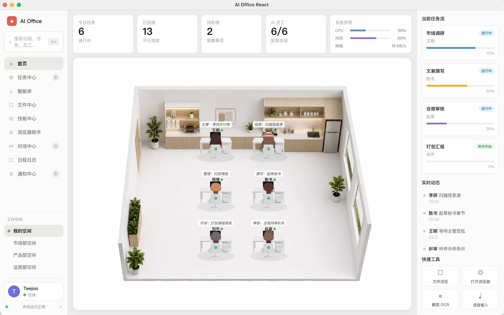

# AI Office React

AI Office 是 OpenPaw 的办公室交互界面。当前系统由 React 前端、Action Gateway、OpenPaw engine-host 和模型 Provider 共同组成，支持办公室动画、会话、任务、文件、技能、权限、日程和通知等界面。

> 当前审计裁决（2026-09-17）：核心两仓 B 线对话、多会话、长文本、失败恢复、端口和 OpenPaw 独立运行已通过本轮验证；完整发布仍被 OpenWork T7/T9、可靠动画 v2、冻结提交和人工发布审批阻断。

权威文档统一记录在：

- [需求基线](./docs/01-需求基线.md)
- [设计与实现](./docs/02-设计与实现.md)
- [测试大纲](./docs/03-测试大纲.md)
- [验收记录](./docs/04-验收记录.md)

## Windows 一键启动

先完成 OpenPaw Windows engine-host 构建和 AI Office 依赖安装。首次联调先使用本地 mock，确认二进制、端口、Gateway 和页面链路正常，避免把外部模型、密钥或网络问题混入本机环境排查：

~~~powershell
cd D:\workSpace\KunlunMeta_Git\chenningbo\kunlun
.\start-demo-native.ps1 -Provider mock
~~~

三端健康后，再进行一次受控的真实模型烟测：

~~~powershell
cd D:\workSpace\KunlunMeta_Git\chenningbo\kunlun
.\start-demo-native.ps1 -Provider openai -Model gpt5.6
~~~

脚本默认启动并检查三个本机服务：

| 服务 | 默认地址 |
| --- | --- |
| AI Office 前端 | http://127.0.0.1:5173 |
| Action Gateway | http://127.0.0.1:8765 |
| OpenPaw engine-host | http://127.0.0.1:4096 |

启动脚本会检查端口、Windows Host 二进制、前端依赖和三端健康状态。模型密钥及可选 Base URL 从 OpenPaw `.env` 或当前进程环境读取，密钥不得写入仓库。`mock` 用于环境和并发验证；`openai/gpt5.6` 用于真实 Provider 烟测，不能用 mock 结果替代真实模型结论。

## 前端开发启动

~~~powershell
npm ci
npm run dev
~~~

npm run dev 启动 Vite 和 Action Gateway。单独启动命令为：

~~~powershell
npm run action-gateway
npm run dev:vite
~~~

常用配置：

~~~powershell
$env:OFFICE_ACTION_GATEWAY_PORT = '8765'
$env:OPENPAW_ENGINE_HOST_URL = 'http://127.0.0.1:4096'
$env:VITE_OFFICE_HTTP_ACTIONS_URL = 'http://127.0.0.1:8765/actions'
~~~

## /actions 兼容性

早期 README 中合法的核心动作仍受支持：

- desk_visit
- desk_visit_tour
- set_state
- POST /actions
- GET /actions

对旧 README 明文示例保持核心兼容：三类合法动作和 `POST/GET /actions` 仍可使用。旧 README 没有冻结 POST 成功状态码；历史 Gateway 与当前 Gateway 对合法 POST 都返回 `202 Accepted`，因此 `202` 不是本轮新增的不兼容项。当前实现真正收紧的是输入校验、批次原子性和浏览器 CORS：非法 JSON、未知动作、非法字段或非法批次返回 `400`，整批有一项非法时零项入队，浏览器 Origin 必须命中白名单。`GET /actions` 仍按 FIFO 返回并清空已读取队列。

示例：

~~~powershell
$body = @{ type = 'desk_visit'; visitor = 1; host = 3; message = '读取项目文件' } | ConvertTo-Json
Invoke-RestMethod -Method Post -Uri 'http://127.0.0.1:8765/actions' -ContentType 'application/json' -Body $body
~~~

/actions v1 只用于尽力而为的动画投影，不是会话、任务或执行结果的可靠事实源。它没有 session/turn/eventId、ACK、cursor 和 replay；多会话严格联动的 v2 方案仍处于两仓 draft CHG。会话事实由 OpenPaw session JSONL 和 Host 回合终态维护。

## 当前连接方式

对话不再通过 `/actions` 承载。React 调用 Gateway 的类型化 `/office/*` 接口，Gateway 将异步回合提交给 OpenPaw Host；Host 负责同会话互斥、跨会话并行、全局并发/队列、Provider 调用和 session JSONL 持久化。React 再按目标 session 查询状态、正文和脱敏终态。默认允许 4 个不同 session 同时运行、32 个排队，同一 session 同时只允许一个回合。

这种职责分离比把动画队列当业务总线更合理：Host 是唯一会话写入者，动画丢失不会改变任务结果，不同 session 具备独立执行基础。当前候选已通过多会话切换、长文本 UTF-8、失败正文、刷新恢复和当前源码身份绑定的三端测试。性能仍需分路径判断：缓存命中的会话摘要较快，完整回复仍受 Provider、工具、审批、网络、持久化和 Markdown 渲染影响；可靠多会话动画 v2 尚未实施。

## 验证

~~~powershell
npm run lint
npm run build
npm run test
npm run test:e2e
~~~

历史测试结果不能替代当前工作树验证。当前候选版本的实际命令、退出码和未执行项统一回填到 [验收记录](./docs/04-验收记录.md)。

## 素材

使用或分发 public/assets 下的素材前，应单独确认版权和授权范围。
