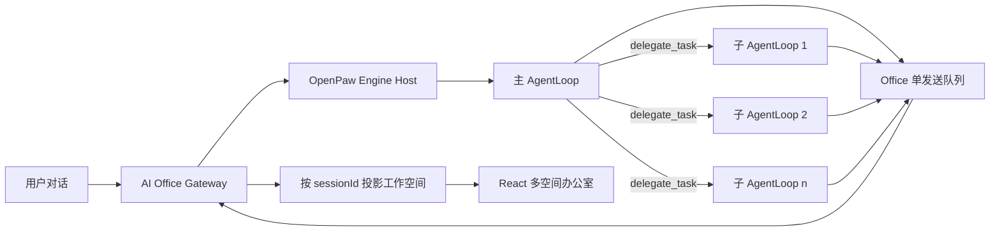
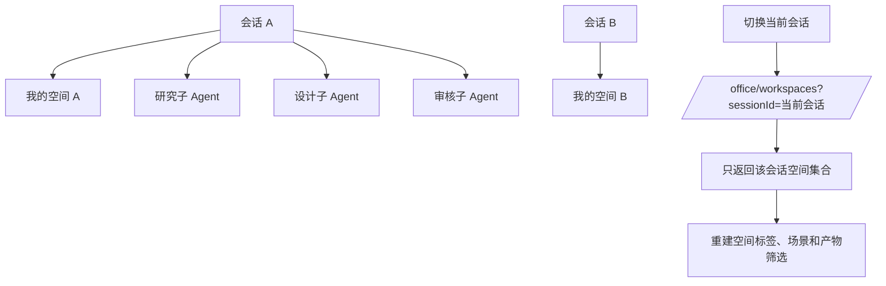

# CHG-2026-0016：多 Agent 空间复审与目标任务中心

## 1. 复审结论

复审日期：2026-09-28。

本轮针对真实主/子 Agent、多会话动态工作空间、跨空间 UI 联动和目标任务中心进行了 Rust、系统架构、前端及测试交叉复审。当前结论为**条件通过，可作为当前基线**：

1. `openpaw-engine-host` 已提供真实 `delegate_task` 子 Agent，每个委派拥有独立 `AgentLoop`、内存会话和 Office 子空间，不是前端伪造的角色动画。
2. 工作空间按 `sessionId + workspaceId` 隔离。无委派的会话只有“我的空间”，发生真实委派后按该会话实际子 Agent 数量动态增加空间。
3. 主/子 Agent 状态、跨空间交接、产物归属和会话切换已贯通 Host、Gateway、React 和办公室场景。
4. 任务中心已从普通对话入口改为目标执行入口，支持目标、完成标准、规划/快速模式、执行阶段、失败诊断、取消、重试和终态删除。
5. Host `97/97`、前端 `150/150`、Playwright `12/12`、三端多子 Agent 系统测试、容量测试及 OpenAI-compatible 100 轮稳定性测试均通过。

这里的“工作空间隔离”是会话、状态、UI 和产物索引隔离。子 Agent 仍共享父 Agent 的物理工作目录，通过 Host 内写锁避免并发写竞争；本版本不宣称提供独立 worktree、文件快照或可恢复的一等子会话。

## 2. 设计实现

### 2.1 多 Agent 执行链

实现边界：

- 每个父会话最多同时运行 4 个子 Agent，第 5 个等待父会话子 Agent 槽位。
- 父、子 Agent 共用 Host 级模型请求限流，避免子 Agent 绕过 Provider 并发上限。
- abort 会取消调度等待、主 Agent、子 Agent、工具调用和人工审批。
- 同一物理工作区的 `write_file`、`edit_file`、`notebook_edit`、`bash`、`todo_add`、`todo_update` 共用异步写锁。
- 未配置 Office 动作地址时不暴露 `delegate_task`，保持 OpenPaw 独立运行边界。

### 2.2 会话与空间投影

- Gateway 使用 `sessionId + workspaceId` 作为状态键，同名子空间不会跨会话串状态。
- `workspace_handoff complete` 不创建不存在的空间；删除会话后迟到动作被墓碑拒绝，不能复活已删除空间。
- Gateway 状态日志支持重启恢复；损坏行跳过，不影响其它会话。
- 一对多并行交接使用 `relations[]`；完成一条关系不会清除其它仍在进行的交接。
- 前端未选会话时不请求空间全集，只展示默认主空间，避免旧会话空间泄漏到新对话。

### 2.3 任务中心目标模式

任务中心与对话中心的职责区分如下：

| 能力 | 对话中心 | 任务中心 |
| --- | --- | --- |
| 核心对象 | 连续消息和上下文 | 有终态的目标任务 |
| 输入 | 当前问题 | 目标、完成标准、优先级、执行模式 |
| 生命周期 | 等待、回复、失败、取消 | 规划、执行、验证、交付、失败、取消 |
| 失败处理 | 在消息历史保留失败正文 | 显示失败阶段、错误码、是否可重试和建议操作 |
| 再执行 | 继续发送消息 | 建立带 `parentTaskId` 和递增 `attempt` 的重试任务 |
| 删除 | 删除会话 | 仅允许删除 completed、failed、cancelled 终态任务 |

任务中心不展示或保存模型隐藏思维链。“思考模式”实现为可审计的公开规划阶段和阶段结果；`auto_plan` 先形成计划再执行，`quick` 直接进入执行，但两者都必须经过真实状态更新，不能使用固定百分比伪装进度。

删除规则：

1. 活动任务删除返回 `409`，用户应先取消。
2. 终态任务删除返回 `204`，只删除任务 Markdown，不删除关联对话、Host session 或产物。
3. 原任务存在重试记录时，必须先删除重试记录，避免断开重试链审计关系。
4. 不存在任务返回 `404`，非法任务编号返回 `400`。

## 3. 逐项复审

| 要求 | 状态 | 实现与验证 |
| --- | --- | --- |
| 主 Agent 可委派真实子 Agent | 满足 | `delegation.rs` 创建独立子 `AgentLoop`；Rust 测试验证真实返回、异常、取消和审批 |
| 工作空间可动态增加 | 满足 | Host 发出子空间动作，Gateway 按真实 `workspaceId` 建立完整六人空间，不使用静态空间数组 |
| 每个对话空间数量不同 | 满足 | 三端测试中会话 A 为 1 主 + 3 子，会话 B 仅 1 主；Playwright 验证切换不串空间 |
| 多子 Agent 并行 | 满足 | 单父会话 4 槽；父/子 Provider 请求共享 Host 级限流；第 5 个委派等待 |
| 多空间 UI 联动 | 满足 | 状态、产物、跨空间关系和交接路线按动作实时投影；一对多交接不会互相覆盖 |
| 切换、刷新和 Gateway 重启恢复 | 满足 | Playwright 覆盖切换；三端测试验证 Gateway 重启后恢复 4 个空间和 3 个子空间产物 |
| 删除会话不复活空间 | 满足 | Gateway 串行墓碑校验和 Host 发送前二次校验，迟到动作返回 ignored |
| 任务中心可删除 | 满足 | 仅终态可删除，活动态 409；UI 有确认和约束提示 |
| 任务失败体验 | 满足 | 保留失败原因、失败阶段、错误码、可重试标记、建议操作和关联会话 |
| 任务重试可审计 | 满足 | 重试继承目标、完成标准、模式，记录 `parentTaskId` 和 `attempt` |
| 任务与普通对话有明确区别 | 满足 | 创建 Prompt、字段、生命周期、失败与删除语义均独立设计 |
| 子 Agent 物理目录隔离 | 未实现 | 当前共享父工作区并用写锁保证 Host 内一致性；独立 worktree 会扩大生命周期、产物合并和清理范围，本基线暂不引入 |
| 子 Agent 独立持久化会话 | 未实现 | 子过程保存在内存，最终结果进入父回合；重启后不能恢复子 Agent 内部步骤 |
| Office 投影强一致、零丢失 | 未实现 | 仍遵守原设计：容量 128、单次 500ms、不重试、失败不改变 Agent 结果；这是动画旁路而非业务事实源 |

## 4. 测试结果

### 4.1 Rust 与工程门禁

| 命令 | 结果 |
| --- | --- |
| `cargo test -p openpaw-engine-host --features engine-host` | 退出码 0；`65 + 13 + 19 = 97/97` |
| `cargo clippy -p openpaw-engine-host --features engine-host -- -D warnings` | 退出码 0 |
| `npm run test` | 退出码 0；9 个文件，`150/150` |
| `npm run lint` | 退出码 0 |
| `npm run build` | 退出码 0；仅有大 chunk 警告 |

Rust 测试覆盖：真实子 Agent、唯一子空间、多父会话隔离、第 5 个委派等待、父子共享模型容量、父子写锁、取消传播、审批清理、删除竞态、FIFO 调度和异常恢复。

### 4.2 浏览器与三端验证

| 测试 | 结果 | 关键证据 |
| --- | --- | --- |
| `npm run test:e2e -- --workers=1` | `12/12` 通过 | 任务创建/删除、多会话并发切换、停止、隐藏办公室、移动端、长回复、失败保留、动态空间和跨空间交接 |
| 多会话专项重复 | `5/5` 通过 | 批量状态、逆序完成、运行中创建、切换、取消和失败正文收敛 |
| `npm run test:system:subagent` | 通过 | 会话 A 为 4 个空间；会话 B 为 1 个空间；3 个子产物独立；Gateway 重启恢复 |
| `npm run test:system:capacity` | 通过 | 4 个运行、32 个排队，第 37 个明确 `429 queue_full`，前 36 个全部完成 |
| OpenAI-compatible 100 轮 | 通过 | 8 个会话、4 个客户端并发、100/100 完成，无失败记录 |

浏览器测试曾与三端多子 Agent 浏览器测试并行运行，首次导航和多会话用例因本机 GPU/浏览器资源竞争超过 30 秒。复审同时发现多会话 E2E 夹具只模拟逐会话状态，而生产控制器优先读取 `/office/conversations/status` 批量状态；测试已补齐同协议批量状态响应。修复后专项顺序重复 `5/5`、完整 Playwright `12/12` 通过。发布门禁应使用 `--workers=1` 串行运行重量级浏览器套件，避免资源竞争造成假失败。

100 轮测试使用本地 OpenAI-compatible fixture 验证协议适配、并发和故障分类，不访问外部 DeepSeek/OpenAI 网络，也不消耗线上额度。它不能替代外部供应商 SLA 或真实公网稳定性证明。

### 4.3 故障与破坏性场景

- Provider `429`：Host 记录 `provider_rate_limited`，Gateway 持久化可读失败正文。
- Provider 超时：Host 记录 `provider_timeout`，后续回合可继续。
- 不完整响应：Host 记录 `provider_protocol_error`，不留下永久 busy。
- Office 投影失败：Host 回合仍完成，Gateway 对话结果不丢失。
- 会话删除竞态：队列和日志清理，迟到动作被忽略。
- 页面切换和刷新：当前会话、长回复、失败消息和未读状态恢复。
- 多会话并行：允许不同会话同时运行；同一会话重复 prompt 仍按协议拒绝。

## 5. 完成证据

- 最新多空间实体 UI 截图：`test-results/subagent-workspaces-1790627372216.png`
- 100 轮报告：`test-results/conversation-real-three-end-23276-1790627038674.json`
- 容量报告：`D:/workSpace/KunlunMeta_Git/_diagnostics/capacity-21324.json`
- Host 构建清单：`D:/workSpace/KunlunMeta_Git/openpaw_merge/target-windows/debug/openpaw.exe.build-manifest.json`
- Host binary SHA-256 前缀：`f99510d1b04e`
- Host source fingerprint 前缀：`ef1c51eb873a`

三端实测输出：

- 会话 A：主空间 + 3 个真实子 Agent 空间。
- 会话 B：只有主空间。
- 子空间产物：`reports/research.md`、`reports/design.md`、`reports/review.md`，分别归属对应子空间。
- Gateway 重启后：恢复 4 个空间，产物归属保持不变。

## 6. 保留风险和发布约束

1. 子 Agent 共用父物理目录。同一路径的顺序后写仍可能覆盖旧内容；需要内容级版本时，应后续引入独立 worktree 或产物快照，而不是继续扩大当前写锁。
2. 子 Agent 不是可独立查询、可恢复的一等 Host session。当前适合临时委派和结果汇总，不适合长时间跨重启执行。
3. Provider 限流只在单 Host 实例内生效。多个 Host 不能共用同一 Provider 账号并指望进程内 semaphore 提供全局限流。
4. 多 Host 不应共用同一个 `OPENPAW_HOME` 和物理工作区；部署时必须分离 home/workspace。
5. Office 投影是 best-effort。Gateway 长时间不可用或队列满时，动画和空间状态可能缺失，但 Agent 回合和对话结果不应失败。
6. `workspace_write_locks` 和删除墓碑目前无 TTL；长期高基数工作区/删除会话部署需要后续增加回收策略。
7. `bash` 写入受锁保护，但其生成文件不会自动登记为空间产物；当前自动登记限于受支持的文件写工具。
8. 任务阶段由 1.5 秒轮询更新，持续时间很短的“验证/交付”阶段可能只保留最终状态，而不会在 UI 中逐帧展示。
9. 当前两个仓库仍有未提交和未跟踪的生产文件；完成提交并记录构建清单前，只能称为候选基线，不能称为可完全复现的正式发布版本。
10. 生产构建主 JS 约 1.277 MB；不影响本轮功能验收，但后续应按办公室场景、Mermaid 和图表查看器拆分异步 chunk。

## 7. 变更范围与回滚

OpenPaw 改动限定在 `crates/openpaw-engine-host`，未把 Office 兼容能力移动到 `openpaw-core` 或 `openpaw-engine`。AI Office 改动集中在 Gateway、Dashboard、空间视图、动作投影、类型和测试。

任务字段、删除路由和 UI 可按本 CHG 独立回滚；新增任务 frontmatter 字段均为可选，旧版本会忽略。回滚不得删除用户已有对话、任务文件、空间状态日志或工作区产物。
