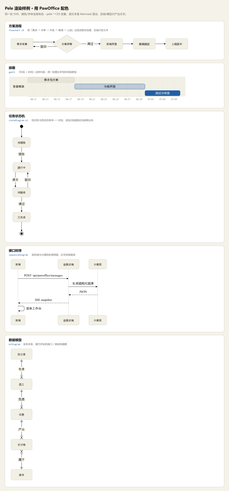

# Pele 引入评估（PawOffice）

调研日期：2026-10-27 ｜ 结论页，先读这份 ｜ 证据：[pele-technical-profile.md](./pele-technical-profile.md)（Pele 本体 900 行）、[pawoffice-integration-surface.md](./pawoffice-integration-surface.md)（本仓库接入面）

---

## 0. 结论

1. **建议引入，但只作为「图（diagram）」这一类的表达通道**，不是替换 `table / chart / stats` 等现有原语，也不是替换 `react-markdown`。它解决的是上一轮讨论里的那个真问题：*「结构化数据 + 前端渲染，每种组件都要预先开发，灵活性受限」*——网络图/流程/时序/状态机这类内容，靠原语组合永远拼不出来，靠手写 SVG 不可能覆盖 33 种。
2. **许可没有障碍**。Pele 是 MIT（`Copyright (c) 2026 kepano`），允许商用、闭源、修改、再分发；唯一义务是随分发物保留版权声明与许可全文。Pele 的 `LICENSE` 里另含一段 **Lucide ISC**（zoom 控件图标已打进 dist），所以第三方声明要同时收录这两段——本仓库现有的 `scripts/third-party-notices.mjs` 正好按「整份 LICENSE 文本入库」工作，天然满足。
3. **落地顺序**：先做聊天/白板的 Markdown mermaid 代码块渲染（1–2 人日，不改协议），验证视觉与真实需求；再决定是否进协议当 `diagram` block（3–5 人日）。**不要**为了它去改 `packages/runtime`（架构测试锁死了 runtime 的导入白名单），也**不要**用 `file:`/vendor 方式引入（声明脚本会直接 fail）。

一句话：**它是「图」这个长尾的唯一低成本解，体积账（按需 15–63 KiB gzip）比任何自研方案都划算；风险是项目太年轻（3 周、日更、单人主导），所以锁死版本 + 保留回退开关。**

---

## 1. 事实基线

### 1.1 Pele 是什么

| 项目 | 事实 | 来源 |
| --- | --- | --- |
| 仓库 / 官网 | `github.com/obsidianmd/pele` / `pele.run` | 仓库 README |
| 作者 | kepano（Obsidian CEO Steph Ango），Obsidian 组织维护 | `package.json` / 官网 |
| 许可 | **MIT**，`Copyright (c) 2026 kepano`；LICENSE 内附 Lucide ISC 段 | `LICENSE` |
| 最新版 | **1.12.0**（2026-10-26 发布）；1.0.1 起（2026-10-06）才接管 npm 名字 | npm registry |
| npm 包 | **`pele`**（就是这个项目；`pele@1.0.0` 是 2020 年无关旧包，勿混淆） | registry `repository` 字段 |
| 生产采用 | **Obsidian 1.15.0（2026-10-22 早期访问）已用它替换 Mermaid.js**，`window.pele` 对外暴露 | [Obsidian changelog](https://obsidian.md/changelog/2026-10-22-desktop-v1.15.0/) |
| 能力 | Mermaid 12.1.0 语法 → SVG，**33 种图**（覆盖 Mermaid 12.1.0 全部内置类型） | 仓库 `src/diagrams/registry.ts` |
| 运行时依赖 | **0**（纯 ESM + TypeScript，`engines: node >=20`） | `package.json` |
| 渲染模型 | **同步、无 DOM 访问**，Node/Web Worker 可跑；`mount()` 才需要 DOM | `AGENTS.md` / `core.ts` |
| 主题 | 全部走 CSS 变量 `--pele-*`；**换色零重渲染**，换字体需 `refresh()` | README / 实测 |
| 中文 | 内置 CJK 宽字符测量（全角按 1em）+ CJK 断行（1.7.0 起，含禁则） | 仓库 `tests/render/cjk-wrap.test.ts` |
| 不兼容点 | 自研布局引擎，**节点位置/间距/连线与 Mermaid 不同**；不支持 `themeVariables`、ZenUML 等外部插件、HTML label、点击 JS 回调 | 官网 compatibility |

外部事实（2026-10 的报道，供交叉验证）：kepano 自述「比 mermaid.js 快 100–500×、包体约 1/6、零依赖」；[gihyo](https://gihyo.jp/article/2026/10/pele) 记录 1.7.0 加入中日文断行、1.8.0 加入 `math` 选项。

### 1.2 体积（本机实测，npm 发布包 `pele-1.12.0.tgz`，Node 22 zlib）

| 形态 | min | gzip | brotli |
| --- | --- | --- | --- |
| 全量 `dist/pele.js`（33 种图） | 709 KiB | **268.5 KiB** | 217 KiB |
| `pele/lazy` 入口（按需拉 chunk，初始） | 37 KiB | **15.3 KiB** | 14 KiB |
| `pele/core` + flowchart | 137 KiB | **55 KiB** | 48 KiB |
| `pele/core` + 常见 5 种图 | — | **111.5 KiB** | — |
| 对照：Mermaid 12.1.0 `mermaid.min.js` | 5,364 KiB | **1,546 KiB** | 1,149 KiB |

- Mermaid 有 23 个直接依赖（d3/dagre/cytoscape/khroma…），Pele **0**。同级对比 **约 1/5.8（gzip）**。
- 官网宣称「230 kB gzip」比实测偏乐观，按 268.5 KiB 记账。
- 关键：**可以按图类型懒加载**，不用一次吃 268 KiB。

### 1.3 本机跑通的行为（比 README 更可信的证据）

| 场景 | 结果 |
| --- | --- |
| 6 节点中文流程图 / 时序图 / 状态机 | 6–16 ms 首次（含冷启动），输出 3.4–4.2 KiB SVG |
| 80 节点中文流程图 | **20.3 ms 首次 / 2.5 ms 热**，SVG 35 KiB |
| 长中文标签 | 传 `maxWidth` 时自动折行（`<br/>` 亦支持）；不传则单行撑宽 |
| 恶意标签 ``、`</svg><script>` | 输出中无 `<script>`、无 `` —— **标签文本被转义** |
| 语法错误 | `PeleError.code='syntax'`，带行号、列号、上下文片段 |
| 无法识别 / 超限 | `code='unsupported-diagram'` / `code='limit'`（源码 50,000 字符、输出 4 MB、边 5,000 条） |
| Node 内渲染（无 DOM） | 正常产出 SVG —— 可做 SSR/构建期预渲染 |

### 1.4 安全模型

- 转义图内文本、过滤链接 scheme 与 style、限制源码/输出/边数/嵌套深度；仓库自带 30 个安全测试 + 差分 fuzz。
- **它不能执行代码**——这是 Obsidian 敢「不再询问就显示 Mermaid 图」的原因（changelog 原文）。
- 对比后端 HTML + iframe：没有第二套运行时、没有跨域、没有 CSP 放宽、没有任意 CSS。

---

## 2. 对 PawOffice 的提升

### 2.1 补上「图」这个长尾，直接回答「组件都要预先开发怎么办」

现状：`result` 侧 11 种原语（heading/text/keyValue/stats/table/list/progress/chart/image/callout/divider）+ 4 种布局，`chart` 原语只有 **bar/line/pie 三种手写 SVG**（`docs/architecture/result-workspace.md` 明确记着「图表为手写 SVG（无新增依赖）」）。能表达的「关系」几乎为零。

引入 Pele 后，**同一段后端数据**可以长这样（后端/模型只产出文字，前端零新增组件）：

```json
{ "type": "diagram", "title": "登录模块调用链",
  "source": "sequenceDiagram\n  participant F as 前端\n  participant B as 业务后端\n  F->>B: POST /messages\n  B-->>F: SSE snapshot" }
```

收益是可量化的：

| 维度 | 现状 | 加 Pele 之后 |
| --- | --- | --- |
| 可表达的「图」类型 | 0（chart 仅 3 种统计图） | **33 种**：流程图、时序、状态机、ER、甘特、思维导图、时间线、象限、C4、架构、泳道、看板、桑基、雷达…… |
| 新图类的开发成本 | 一类一个组件 + 设计/a11y/测试 | **0**（文本换一种写法） |
| 后端耦合 | 只能发原语 JSON | 仍只发数据/文本；不是 HTML，不是 iframe |
| 模型输出成本 | 生成 SDUI JSON（层级多、字段多） | 生成 Mermaid 文本（**同样 8 个节点，估算是 JSON 的 1/3–1/5 token**） |
| 首屏增量 | — | `lazy` 入口 **15 KiB gzip**，点开图才拉 8–54 KiB/类型的 chunk |
| 主题一致性 | 现成设计令牌 | `--pele-*` 直接映射 PawOffice 令牌，**换色不重渲染**；暗色/暖色自动跟随 |
| 响应式 | 原语自己处理 | `maxWidth` 让横向流程图自动改纵向、长标签自动折行 |
| 安全面 | `dangerouslySetInnerHTML` 只喂本地转义 HTML | Pele 产出的 SVG 由渲染器自己转义/过滤，仍不引入后端 HTML 执行面 |

**具体场景**（都能对上现有 UI）：

- 聊天：模型回复里本来就会写 mermaid 代码块，今天和其它代码块一样落到 `<pre><code class="language-mermaid">` 纯文本（`tests/chatMarkdown.test.mjs:20` 钉死了这个通用代码块形状）——**只改一个 `code` 渲染器就能成图**。
- 成果页：`custom` section 里加 `diagram` block → 「接口调用时序」「任务状态机」「数据模型」「发布流程」。
- 白板 `detail`：任务说明里的流程图不再是一坨代码。

### 2.2 视觉样例（同一份 SVG，仅换 CSS 变量）



五种图（流程图 / 甘特 / 状态机 / 时序 / ER）都用 PawOffice 的暖色令牌（`#fffcf0` / `#100f0f` / `#205ea6`）渲染，中文标签正常折行。这说明「视觉不一致」不是硬伤——Pele 的观感是干净扁平的，和当前成果页风格兼容；真正不一致的只有**布局算法与 Mermaid 不同**（节点位置会变），不是配色。

### 2.3 与替代方案的取舍

| 方案 | 灵活性 | 前端成本 | 体积 | 安全面 | 评价 |
| --- | --- | --- | --- | --- | --- |
| 手写 SVG 组件（现状 chart） | 低 | 每类一次 | 0 | 最小 | 适合固定统计图，不适合关系图 |
| **Pele（推荐）** | 33 种图 | **一次接入** | 15–63 KiB 按需 | 小（不能执行代码） | 图类唯一低成本解 |
| Mermaid.js | 33 种图 | 一次接入 | **1.5 MiB gzip + 23 依赖** | 中（需 `securityLevel`/sanitize 配置） | 体积不可接受 |
| 后端预渲染图片（`result.image`） | 取决于后端 | 0 | 图片流量 | 小 | 主题/缩放/选中/暗色全丢，token 也更贵；只适合「一次性外链」 |
| HTML + iframe | 最高 | 低 | — | 大（sandbox/CSP、双运行时） | 上一轮已否掉的逃生通道 |

---

## 3. 接入方案（分级，含落点）

> 约束（已核对）：`tests/architecture.test.mjs` 断言 `runtime/src/index.ts` 的导入恰好是 `['pathfinding','zod']`，`protocol` 只允许 `zod` → **Pele 只能进 `apps/web`**，不能进 `packages/runtime|protocol`。仓库当前**没有 CSP、没有 sanitizer**，唯一的 `dangerouslySetInnerHTML` 喂的是本地转义过的字符串。

### A. 聊天 / 白板 Markdown（P0，1–2 人日，不改协议）

- 新建 `apps/web/src/components/MermaidDiagram.tsx`：`render()` + `maxWidth` + 缓存 + 错误降级 + `role="img"` + `aria-label`。
- 在 `ChatMarkdown.tsx`、`WhiteboardDetail.tsx`、`ResultBlocks.tsx`（text 块）各加一个 `code` 覆盖：语言是 `mermaid` 且 `pending === false` 时渲染图，否则保持现有 `<pre>` 文本。
- 要点：
  - **流式期间不要渲染**（每 delta 重排会抖，且 `ChatSession.ts:210-214` 逐块更新）；
  - 按 `source + 宽度桶` 做 LRU 缓存，避免虚拟列表滚动反复重算；
  - 宽度用 `ResizeObserver` 取容器宽传 `maxWidth`，**图高变化会让虚拟列表跳**，给容器一个稳定的 `min-height` 或先按 `svg.height` 占位；
  - 单图源码上限（如 8,000 字符）+ 每次消息最多 N 张图。
- 验收：`chatMarkdown.test.mjs` 既有断言（非 mermaid 代码块不变、mermaid 在 pending 时仍是文本）+ 新增恶意标签用例（断言输出无 `<script`/`on*=`）+ 桌面/窄屏截图。

### B. 其它 Markdown 出口（P0，复用 A 的组件）

`WhiteboardDetail.tsx`、`result.text` 原语、`artifacts[].content`（`ResultReader.tsx:127`）都是 `react-markdown`，换同一个 `code` 覆盖即可。注意白板**墙上**是 Pixi `HTMLText`（`referenceOffice.ts:106-136`），SVG 塞不进去——图只在 DOM 详情面板里显示，两处表现会不一致，需要在文案上接受或让墙上只显示「[图]」。

### C. 协议级 `diagram` block（P1，3–5 人日）

```ts
// packages/protocol/src/office-ui.ts（新增到 resultBlockSchema 判别联合）
export const chartDiagramBlockSchema = z.strictObject({
  type: z.literal('diagram'),
  title: z.string().max(60).optional(),
  source: z.string().min(1).max(8000),        // Mermaid 文本，≤8k（Pele 硬限 50k，取更小的业务上限）
  caption: z.string().max(200).optional(),
  maxHeight: z.number().int().min(120).max(720).optional(),
})
```

- **能力协商**：在 `office.capabilities` 暴露 `diagram: { syntax: 'mermaid@12.1', maxSource: 8000 }`；旧客户端不认识 `diagram` 时，现有注册表兜底已会渲染灰色「暂不支持」卡片（`ResultBlocks.tsx` 的 fallback），不会白屏。
- **必须同步改**：`result-workspace.md` 里「图表为手写 SVG（无新增依赖）」这条设计决策要补一条 ADR 例外——chart 原语仍手写，**关系图**走 Pele。
- **不改旧行为**：`diagram` 可选；不发的快照渲染结果与 v1/v2 完全一致。

### D. 明确不要做的

- ❌ 在 `packages/runtime` / `protocol` 里 import `pele`（架构测试会红）。
- ❌ `file:` / vendor 目录引入（`third-party-notices.mjs:72` 直接 `Unreviewed dependency location`）。
- ❌ 把后端/模型给的 HTML 或 SVG 字符串丢进 `dangerouslySetInnerHTML`——**只允许 Pele 从文本生成的 SVG**。
- ❌ 用 iframe 兜底图（上一轮已评估过的逃生通道，图这种高频内容不该走它）。
- ❌ SSR 阶段真渲染：`resultWorkspace.test.mjs` 会 `react-dom/server` 渲染组件，Node 无 canvas → 用 Arial 宽度表，和浏览器输出不一致会 hydration 抖动。**SSR 输出 `<pre>` 占位（带 `aria-label`），客户端再换成图**。

### 打包建议

- 图类型不可预知 → `pele/lazy`（初始 15 KiB gzip，按需 chunk，天然 code-split）。
- 若产品只允许固定 6–8 种图 → `pele/core` + `pele/diagrams/*` 精确注册（约 63–112 KiB gzip），少一次网络往返。
- 全量 268 KiB gzip 也可接受（Mermaid 的 1/5.8），但没必要。

---

## 4. 版权 / 许可：会不会有限制？

### 4.1 MIT 给了什么、要什么

MIT 是**最宽松**的一类：可以商用、可以闭源、可以修改、可以再分发、可以只发打包产物。**唯一义务**（原文）：

> The above copyright notice and this permission notice shall be included in all copies or substantial portions of the Software.

即：随分发物保留 **版权行 + 许可全文**，不要求开源、不要求 UI 署名、不要求提交修改、不提供担保。对 PawOffice 这种要发 `dist/`（Vercel/Docker）的产品，落实方式就是**构建产物里的第三方声明文件**——本仓库已经在做。

### 4.2 Pele 许可证的两个细节

1. **LICENSE 里有两段**：MIT（kepano）+ 追加的 **Lucide ISC** 段（zoom 控件的 reset 图标 `rotate-ccw`，v1.14.0 Lucide，**该图标实际打进了 `dist/pele.js`**）。所以打包 Pele 时声明文件要**两段都收**。
2. **ESM dist 内没有版权 banner**（只有 global 版有）。这正说明「必须在分发物里带 LICENSE 文本」，而不是指望产物里自带。

好消息：本仓库的生成器是**把包目录内的 `licen[sc]e`/`copying`/`notice` 文件全文收进 `public/THIRD_PARTY_NOTICES.txt`** 的（`scripts/third-party-notices.mjs:30-52`），Pele 包根目录带 `LICENSE` → 两段会原样收录，**不需要改脚本**。

### 4.3 和现有声明流程怎么对接（已逐条核对脚本行为）

| 检查 | 结果 |
| --- | --- |
| 许可白名单 | `approvedLicenses = ['MIT','ISC','BSD-3-Clause','PSF','BlueOak-1.0.0']`，`pele` 声明 `MIT` → **通过** |
| 包内必须有许可文本 | `pele` 带 `LICENSE` → **通过**（没有才要改脚本加例外） |
| 依赖位置 | 必须是 `node_modules/` 里的正式依赖；`file:`/本地目录 → **直接 fail** |
| 生成/校验入口 | `npm run licenses:generate` 重写 `public/THIRD_PARTY_NOTICES.txt`；`licenses:check` 在 `pretest` 里跑 → **新增依赖后必须重新生成并提交这个 261 KB 文件**，否则 `npm test` 红 |
| 版本锁 | 建议 `pele: "1.12.0"` 精确版本 + 提交 `package-lock.json`；`npm ci` 校验通过 |

### 4.4 其它版权/合规点

- **Mermaid 本身不产生义务**：Pele 只在 `tests/` 里携带 Mermaid 的 spec/grammar（同为 MIT），**不进 npm 包**；我们只是「写 Mermaid 语法文本」，不复制 Mermaid 代码。Pele 附带的 Mermaid 测试语料也不需要出现在我们的声明里。
- **商标**：MIT 不含商标授权。不要在 UI/宣传里用「Pele」「Obsidian」暗示官方背书；写「兼容 Mermaid 语法（由 Pele 渲染）」是事实描述，可以用。
- **素材不覆盖**：第三方声明只覆盖软件依赖，不覆盖美术素材（与本仓库 `README` 第 85–89 行的既有约定一致）。
- **如果将来 fork 修改 Pele**：MIT 允许，但要么保留原声明并注明修改，要么仍按原许可再分发；不建议改成私有协议。
- **供应链提醒**：`pele` 这个名字 2020 年属于另一个无关实验包，2026-10-06 起才由 Obsidian 团队发布新包。务必**锁精确版本**、确认 `repository` 指向 `obsidianmd/pele`、`npm ci` 使用 lock 里的 integrity。

**结论：不会限制商用，也不会要求开源；成本就是「随产物附一份声明」，而这项成本本仓库已经自动化。**

---

## 5. 风险与缓解

| 风险 | 说明 | 缓解 |
| --- | --- | --- |
| **项目极年轻** | 2026-10-05 建仓，3 周 21 个版本、409 commits、单人主导、无 CHANGELOG/安全公告 | 锁 `1.12.0`；封装在 `MermaidDiagram` 后，保留「渲染失败 → `<pre>`」开关；升级按版本走视觉基线 |
| **布局与 Mermaid 不等价** | 自研布局，同一段文本节点位置/间距会变；`themeVariables`、HTML label、ZenUML、点击回调都不支持 | 不承诺像素级一致；存量图用 Playground 对照；对不支持的语法直接降级显示源码 |
| **CJK 字体测量** | 浏览器用 canvas 量宽，Node/SSR 退化 Arial 表；`fontFamily` 必须与 `--pele-font` 一致，否则溢出/留白 | 组件内统一从设计令牌读字体并同时传给 `fontFamily`；SSR 只出占位；换字体后重渲染 |
| **体积** | 全量 268 KiB gzip | 用 `lazy` 或固定类型注册（15–63 KiB） |
| **XSS / 无 CSP** | 仓库无 CSP；一旦有人把后端 HTML/任意 SVG 接进来就破防 | 只允许 Pele 产出的 SVG；加恶意标签单测；可选加 CSP 作为纵深防御 |
| **架构约束** | runtime/protocol 的导入白名单锁死 | 只放 `apps/web`，组件加注释说明原因 |
| **既有设计决策冲突** | `result-workspace.md` 写着「图表为手写 SVG（无新增依赖）」 | 补 ADR 例外：统计图仍手写，关系图用 Pele；理由=覆盖度而非偷懒 |

---

## 6. 建议路线

| 阶段 | 做什么 | 工作量 | 验收 |
| --- | --- | --- | --- |
| **P0（建议立刻做，可只做这一步）** | `MermaidDiagram.tsx` + `ChatMarkdown`/`WhiteboardDetail` 的 `code` 覆盖；懒加载 + 缓存 + 降级 | 1–2 人日 | 聊天里的 mermaid 代码块成图；非 mermaid 代码块与 pending 态行为不变；窄屏截图；恶意标签用例 |
| **P1** | `diagram` block 进协议 + capabilities + 上限；成果页渲染 | 3–5 人日 | 旧快照渲染零变化；新 block 在旧客户端降级为「暂不支持」；`tsc`/测试全绿；`licenses:generate` 已提交 |
| **P2** | 视觉基线（暗色/窄屏/长标签）、按需预加载常用图类型、错误上报 | 1–2 人日 | 视觉回归清单通过；首屏增量 ≤20 KiB gzip |
| **何时不引入** | 若「图」只是极低频需求（比如一个季度几张静态示意图） | — | 先用 `result.image` 外链预渲染图片；等真的每周都要新图再引入 |

---

## 附录 A：本次实测命令与数据

- 克隆：`git clone --depth 50 https://github.com/obsidianmd/pele`（经 `http://127.0.0.1:7897` 代理）
- 发布包：`npm pack pele@1.12.0`，`dist/pele.js` = 726,020 B → **268.5 KiB gzip / 216.9 KiB brotli**（Node 22 `zlib`，level 9 / brotli 11）
- Mermaid 对照：`npm pack mermaid@12.1.0`，`dist/mermaid.min.js` = 5,493,176 B → gzip 1,541 KiB
- 按需闭包：对 `dist/esm/diagrams/<type>.js` 求静态 import 闭包后 gzip（flowchart 55 KiB；core 15 KiB）
- 性能/转义/错误码：Node 22 直接 import `dist/pele.js` 的 `render()`（无 DOM）
- 样例图：Node 渲染 SVG → 解析 `var(--pele-*)` 为设计令牌色值 → `sharp` 转 PNG（本机 headless Chrome 被沙箱拦截，故未用浏览器截图；浏览器里 CSS 变量会原生生效）

## 附录 B：证据文件

| 文件 | 内容 |
| --- | --- |
| [pele-technical-profile.md](./pele-technical-profile.md) | Pele 本体：33 种图逐项体积、API 签名、兼容边界、安全测试、CJK、许可逐条证据、未验证项 |
| [pawoffice-integration-surface.md](./pawoffice-integration-surface.md) | 本仓库接入面：4 个 `react-markdown` 出口、`ResultBlocks` 注册表、协议/架构测试约束、声明脚本行为逐行核对 |
| `./pele-demo.png` | 五种图用 PawOffice 配色的实际渲染（本报告 §2.2） |
