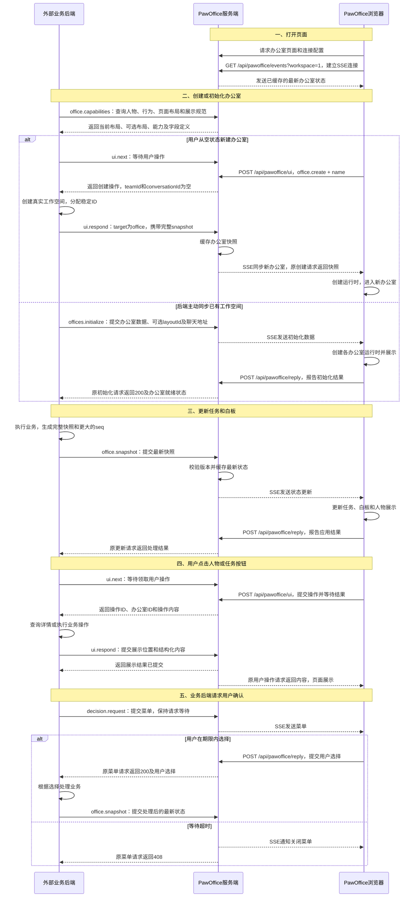
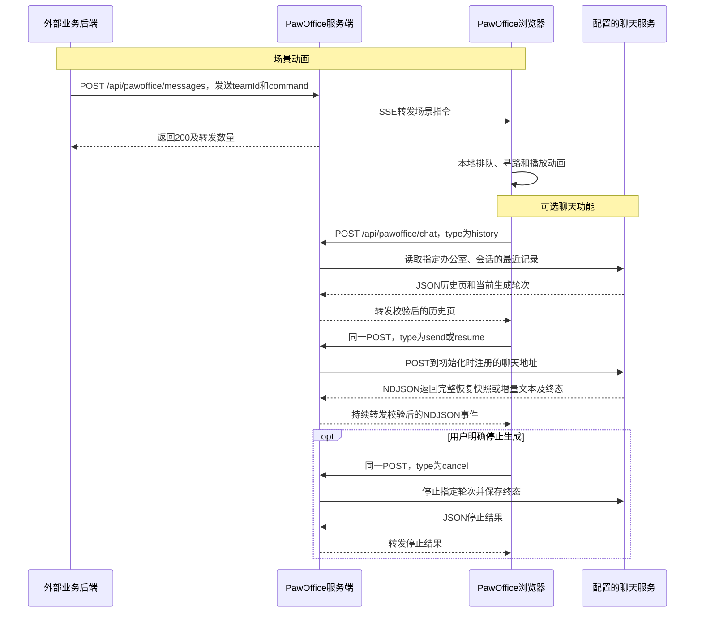
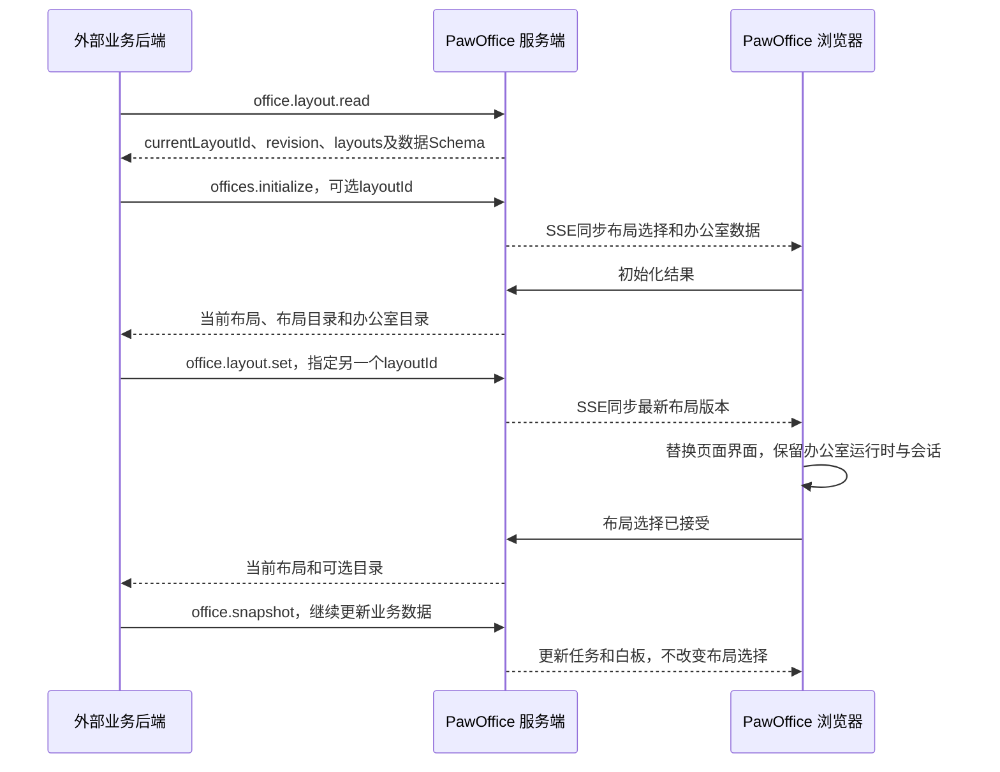
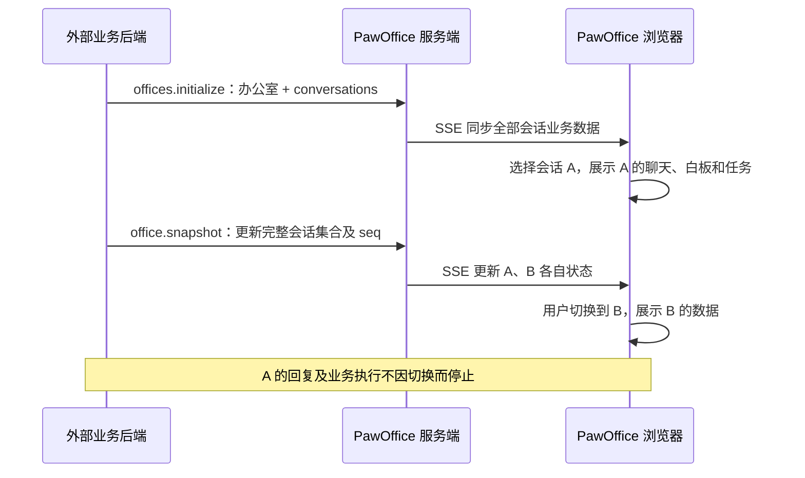

# PawOffice 办公室 HTTP 接入协议

本文面向将业务系统、智能体服务或任务平台接入 PawOffice 的开发者。通过本协议，可以创建办公室、展示成员与任务、更新白板、控制场景行为，以及接收用户操作。

## 通信参与方

| 名称 | 职责 |
| --- | --- |
| 外部业务后端 | 提供办公室、成员、任务和白板数据，执行业务操作，调用 PawOffice HTTP 接口 |
| PawOffice 服务端 | 本项目提供的 Fastify 服务，校验请求、缓存最新业务状态，并将消息发送给浏览器 |
| PawOffice 浏览器页面 | 展示办公室，执行人物动画，接收用户点击和选择 |

外部业务后端调用 PawOffice 服务端。PawOffice 服务端通过 SSE 向浏览器页面发送消息；SSE 是从服务器向浏览器持续发送事件的 HTTP 连接，由 PawOffice 自行建立和管理。

```text
外部业务后端 -- POST /api/pawoffice/messages --> PawOffice 服务端
PawOffice 服务端 -- SSE 消息 --> PawOffice 浏览器页面
外部业务后端 <-- 同一次 HTTP 请求的响应 -- PawOffice 服务端
```

## 完整调用流程

以下流程以服务器部署、浏览器页面在线为例。外部业务后端发送的 `office.capabilities`、`office.layout.read`、`office.layout.set`、`offices.initialize`、`office.snapshot`、`ui.next`、`ui.respond` 和 `decision.request`，均为 `POST /api/pawoffice/messages` 请求体中的 `type`。

图中的 `/api/pawoffice/events`、`/api/pawoffice/reply` 和 `/api/pawoffice/ui` 由 PawOffice 浏览器代码调用。各操作的字段定义见后续章节。



用户操作采用领取方式：外部业务后端持续调用 `ui.next`，处理领取到的操作后用 `ui.respond` 返回展示结果。`ui.next` 每次返回后可再次调用；到期没有操作时返回空列表。详情内容通过浏览器先前发起的 `/api/pawoffice/ui` 请求返回。

### 场景动画与可选聊天



动画请求的成功响应表示已转发，业务完成状态由外部业务后端决定。聊天服务由外部项目提供，通过初始化请求的 `chat.url` 注册；浏览器通过 PawOffice 服务端转发聊天，无需单独配置地址或重新构建前端。接口格式见[聊天流式接口](./chat-integration.md)。

聊天历史和生成状态由外部聊天服务保存。浏览器进入会话时按页同步历史，刷新后恢复同一轮回复；断开接收连接不等于停止生成。`send`、`history`、`resume`、`cancel` 共用已注册的聊天地址，不增加接口地址。

初始化和状态更新返回 `202` 时，表示最新状态已缓存，但该请求没有取得浏览器的应用确认。它可能发生于页面离线，也可能发生于等待浏览器确认的请求容量已满；后一种情况下，在线页面仍可通过 SSE 收到状态。浏览器上线或 SSE 重连时接收最新快照。服务端重启后，外部业务后端需要重新发送初始化。详细版本规则见下文“恢复与顺序”。

## 快速开始

需要 Node.js 22.13+ 或 24+。在项目根目录安装依赖并启动开发服务：

```sh
npm install
npm run dev
```

打开启动日志中 Vite 地址的 `/office/` 页面。在另一个终端运行业务接入示例：

```sh
npm run integration-example
```

该示例创建两个办公室、绑定业务成员、更新任务与白板，并等待用户在页面选择确认或拒绝。运行 `npm run integration-ui-example` 可以接收人物点击和任务按钮操作，并返回详情内容。示例源码位于 [`integration/clients/`](../clients/)。

执行 `npm run test:integration` 可运行独立 HTTP 客户端、真实浏览器和临时 Docker 服务之间的自动验收，覆盖初始化、用户操作、菜单、状态同步及异常恢复。环境要求、范围和报告位置见[端到端验收说明](../../tests/integration-e2e/README.md)。

示例客户端通过 `PAWOFFICE_URL` 指定 PawOffice 服务地址，默认 `http://127.0.0.1:8765`；通过 `PAWOFFICE_API_KEY` 指定访问密钥。开发环境默认密钥为公开演示值 `pawoffice-demo-key`。服务器与 Docker 配置见[消息转发与部署](./message-relay.md)。

下文请求示例使用 `team-a` 作为办公室 ID；首次调用时先执行“初始化办公室”，再发送该办公室的状态更新、菜单和场景指令。

## HTTP 地址与认证

所有办公室业务操作和场景指令都发送到同一个地址：

```http
POST <PawOffice 服务地址>/api/pawoffice/messages
```

每次请求设置以下请求头：

```http
Authorization: Bearer <PAWOFFICE_API_KEY>
Content-Type: application/json
```

将 `<PAWOFFICE_API_KEY>` 替换为与 PawOffice 服务端配置一致的密钥。

## 请求与响应格式

请求体为 JSON 对象。业务请求用 `type` 指定操作，其余字段是该操作的参数。例如，查询办公室 `team-a`：

```json
{ "type": "office.read", "teamId": "team-a" }
```

场景动画请求的顶层字段为 `teamId` 和 `command`，完整示例见下文“发送场景指令”。

每次 HTTP 请求都返回以下结构：

| 响应字段 | 类型 | 含义 |
| --- | --- | --- |
| `code` | 整数 | 与 HTTP 状态码一致 |
| `msg` | 字符串 | 供人阅读的结果说明；程序应根据 `code` 和业务字段判断结果 |
| `data` | 对象 | 该操作的返回数据；列表存放在对象内，例如 `data.offices`、`data.actions` |

例如，等待用户操作时暂时没有可领取的操作，返回：

```json
{ "code": 200, "msg": "OK", "data": { "actions": [] } }
```

失败响应的 `data` 包含 `reasonCode`、`details` 和 `issues`：

```json
{
  "code": 400,
  "msg": "Invalid business message",
  "data": { "reasonCode": "INVALID_MESSAGE", "details": {}, "issues": [] }
}
```

`reasonCode` 用于区分失败原因，`details` 提供补充信息，`issues` 提供字段校验问题。字段类型、必填项和取值范围的机器可读定义（JSON Schema），可通过 `office.capabilities` 查询。

### 通用数据规则

- 请求和响应的任何层级都禁止 `null`。字段必须符合各操作定义的类型。
- 可选字段可以省略。业务快照中的可选文本默认 `""`、列表默认 `[]`、在线标记默认 `false`，未知进度和资源指标默认 `-1`；对象按其字段定义补齐默认结构。
- 办公室 ID、任务名称、版本、时间等必填字段必须提供有效值。具体必填项见各操作及[业务快照字段说明](./dashboard-integration.md)。
- 办公室、场景人物、命令和交互 ID 使用 1–100 个字符，允许英文字母、数字、`_`、`.`、`:`、`-`。业务成员和任务 ID 为 1–100 个字符的非空字符串。
- 时间使用包含时区的 ISO 8601 格式，例如 `2026-10-18T10:00:00Z`。
- JSON 对象嵌套最多 64 层，禁止 `__proto__` 属性。办公室业务和场景指令的单次请求体最大 64 KiB；聊天请求使用独立接口，上限为 512 KiB。
- 业务请求只接受对应 JSON Schema 声明的字段；校验失败返回 `400`。

## 操作与返回时机

| 请求内容 | 返回时机 |
| --- | --- |
| `offices.initialize` | 取得浏览器逻辑初始化结果后返回 `200`；已缓存但未等待浏览器确认时返回 `202` |
| `office.snapshot` | 取得浏览器应用结果后返回 `200` 和 `applied`；已缓存但未等待浏览器确认时返回 `202` 和 `cached`；较旧状态返回 `200` 和 `ignored`；相同版本、相同内容可重试同步 |
| `office.read` | 返回办公室目录，或等待在线页面返回指定办公室的状态 |
| `office.capabilities` | 服务端立即返回人物、物品、行为及 UI 的 JSON Schema，初始化前也可查询 |
| `office.layout.read` | 服务端立即返回当前页面布局及可选布局目录，初始化前也可查询 |
| `office.layout.set` | 缓存布局选择并通知页面；取得在线页面接受结果返回 `200`，未取得页面确认返回 `202` |
| `ui.next` | 领取一个用户操作；等待时间内没有操作则返回 `data.actions: []` |
| `ui.respond` | 服务端接收指定用户操作的展示结果后返回 |
| `decision.request` | 等待用户选择后返回；到期返回 `408` |
| `{teamId, command}` | 指令发送到在线页面连接后返回 `200`；播放由浏览器随后执行 |

初始化、状态更新、布局切换和状态查询等待浏览器处理的默认时限为 10 秒。菜单等待时限默认 60 秒，`timeoutMs` 可设为 1000–300000 毫秒。外部业务后端和反向代理的 HTTP 超时应大于相应等待时限，例如为最长菜单配置 310 秒。

## 页面布局查询与切换

页面布局决定导航、成员和业务面板的排列，不改变办公室内部地图、人物身份或任务状态。目前提供 `classic`（经典布局）和 `members`（成员布局）。

### 获取当前布局与可选目录

独立查询可在办公室初始化前后调用：

```json
{ "type": "office.layout.read" }
```

`office.layout.read` 的 `data`、`offices.initialize` 的响应 `data` 和 `office.capabilities` 的响应 `data` 都包含以下同名字段：

| 字段 | 类型 | 含义 |
| --- | --- | --- |
| `currentLayoutId` | 字符串 | 当前选择的页面布局 ID |
| `revision` | 非负整数 | PawOffice 服务端生成的布局版本，用于自身状态同步；外部后端无需生成或提交 |
| `layouts` | 对象数组 | 当前可选布局目录 |
| `layouts[].id` | 字符串 | 可供选择的布局 ID |
| `layouts[].name` | 字符串 | 布局显示名称 |
| `layouts[].dataMessageType` | 字符串 | 该布局接收业务数据的操作类型，目前均为 `office.snapshot` |
| `layouts[].dataSchema` | 对象 | 该布局业务快照的完整 JSON Schema，包括必需字段、可选字段和默认值 |

`office.read` 不指定 `teamId` 时返回的办公室目录也包含这些布局字段。目录由同一份前端协议定义生成，各查询入口与初始化结果保持一致。

### 初始化指定与运行中切换

初始化时可增加 `layoutId`：

```json
{ "type": "offices.initialize", "offices": [], "layoutId": "members" }
```

此处 `offices: []` 表示不增加办公室，也不删除现有办公室。省略 `layoutId` 保留当前选择；服务实例首次启动时默认为 `classic`。

运行中单独切换，不需要重新初始化办公室或重新投递任务：

```json
{ "type": "office.layout.set", "layoutId": "classic" }
```

切换结果的 `data` 与 `office.layout.read` 使用相同结构。`200` 表示至少一个在线页面已接受该布局选择，不代表全部浏览器已经完成绘制；`202` 表示选择已缓存，页面上线或重连时恢复。请求重复指定同一布局不会增加布局版本。无效 ID 返回 `400`，不改变已有选择。



### 状态范围与数据投递

- 布局选择属于整个 PawOffice 服务实例，不属于某个 `teamId` 或会话。同一实例连接的浏览器页面共用选择；页面按钮切换也会更新服务端状态，因此后端查询可以看到用户的选择。
- 连接模式下，服务端状态优先于浏览器保存的布局偏好与 `?shell=` 参数。纯静态演示没有外部控制，仍使用本地偏好。`?layout=scene` 是仅展示场景的页面入口，不属于可选布局 ID。
- 目前两套布局都投影同一份办公室业务快照。后端继续使用 `office.snapshot` 投递，不需要按布局保存两份任务、成员或白板数据。布局目录分别提供各自的数据 Schema；以后增加专属数据要求时，应更新对应定义。
- 业务数据更新与布局选择是两个操作，`office.snapshot` 不接受 `layoutId`。向当前未显示的办公室更新数据不会切换页面布局。
- 切换布局不销毁办公室运行时、不取消人物活动，也不清除聊天记录、输入草稿或正在生成的回复。
- 服务端只在内存中保存最新布局选择，不保存切换历史。重连和新页面使用最新选择；服务端重启后恢复默认，外部后端可在重新初始化时指定布局。

`/api/pawoffice/layout` 是 PawOffice 浏览器按钮使用的同源内部接口，无需外部项目调用；外部后端的查询、初始化和切换继续共用 `/api/pawoffice/messages`。

## 1. 初始化办公室

`offices` 为办公室快照数组，每项包含办公室身份及完整业务状态：

一个办公室对应一个工作区，`conversations` 列出工作区中的会话。每个会话独立提供成员绑定、任务、动态和当前目标白板。浏览器首次选择目录中的第一个会话；之后保留用户选择，不因后端更新而自动跳转。

```json
{
  "type": "offices.initialize",
  "layoutId": "members",
  "chat": {
    "url": "https://your-host.example/chat"
  },
  "offices": [
    {
      "schemaVersion": "1.0",
      "seq": 1,
      "workspace": {
        "id": "team-a",
        "name": "研发办公室"
      },
      "conversations": [
        {
          "id": "main",
          "title": "登录模块开发",
          "employees": [
            {
              "id": "coding",
              "sceneActorId": "office-lead",
              "name": "代码开发",
              "online": true
            },
            {
              "id": "testing",
              "sceneActorId": "office-lead",
              "name": "自动化测试",
              "online": true
            }
          ],
          "tasks": [
            {
              "id": "task-1",
              "title": "登录模块开发",
              "assigneeId": "coding",
              "status": "running",
              "summary": "实现登录与权限校验。",
              "updatedAt": "2026-10-18T10:00:00Z"
            }
          ],
          "events": [],
          "whiteboard": {
            "template": "task-board-v1",
            "title": "",
            "status": "queued",
            "steps": []
          }
        }
      ]
    }
  ]
}
```

- `workspace.id` 是办公室的稳定 ID，其他操作的 `teamId` 引用该值。
- `layoutId` 可选，选择整个页面的布局；省略时保留已有选择。可选值和数据要求通过 `office.layout.read` 查询，切换不会重建办公室。
- `chat` 可选，为本 PawOffice 服务实例注册聊天接口；`url` 为服务端可访问的完整 HTTP(S) 地址。省略 `chat` 保留已有配置，`chat: { "url": "" }` 停用服务。可使用 `offices: []` 单独更换聊天地址，后续聊天立即生效；配置独立于快照 `seq`，服务端重启后须重新注册。地址只保存在 PawOffice 服务端，不广播给浏览器。详见[聊天接入文档](./chat-integration.md)。
- `conversations[].id` 是办公室内唯一的会话 ID，`title` 是标签显示名称。聊天请求、审批请求及用户操作使用 `conversationId` 引用该 ID。
- `conversations[].employees` 是会话的业务成员列表，可代表员工、功能或智能体。成员 `id` 在该会话内唯一；`sceneActorId` 指定负责展示该成员的场景人物。多个成员可以绑定同一人物，不同会话可有不同的绑定关系。
- 每个办公室提供固定六个人物及对应工位、外观。可绑定人物通过 `office.capabilities` 的 `data.scene.actors`，或初始化结果的 `data.actors` 查询。
- 初始化按 `workspace.id` 新增或更新办公室。请求未列出的办公室保留；此操作不提供删除办公室功能。一个服务实例最多管理 100 个办公室。
- 新增办公室时，其他办公室继续执行各自活动。更新已有办公室使用完整快照和 `seq` 规则，见下文“恢复与顺序”。
- 返回的 `data` 包含 `offices`、`actors`、`supportedMessages`、`sceneCommandProtocol`、`ui`，以及 `currentLayoutId`、`revision` 和 `layouts`。每项 `offices` 含 `id`、`name`、`seq`、`runtimeReady`、`taskCount`。
- `runtimeReady: true` 表示浏览器已创建该办公室的逻辑运行环境；图片资源按需加载。返回 `202` 时，目录中的 `runtimeReady` 为 `false`，表示此响应尚未取得浏览器就绪确认；即使页面实际在线，也应按未确认处理。

## 2. 更新任务与展示状态

```json
{
  "type": "office.snapshot",
  "teamId": "team-a",
  "snapshot": {
    "schemaVersion": "1.0",
    "seq": 2,
    "workspace": {
      "id": "team-a",
      "name": "研发办公室"
    },
    "conversations": [
      {
        "id": "main",
        "title": "登录模块开发",
        "employees": [
          {
            "id": "coding",
            "sceneActorId": "office-lead",
            "name": "代码开发"
          }
        ],
        "tasks": [
          {
            "id": "task-1",
            "title": "登录模块开发",
            "assigneeId": "coding",
            "status": "completed",
            "progress": 100,
            "summary": "实现登录与权限校验。",
            "updatedAt": "2026-10-18T10:05:00Z"
          }
        ],
        "events": [],
        "whiteboard": {
          "template": "task-board-v1",
          "title": "",
          "status": "queued",
          "steps": []
        }
      }
    ]
  }
}
```

`snapshot` 表示该办公室在此版本下的完整业务状态，包含全部需要保留的会话；数组内容替换对应列表，省略的可选字段使用默认值。`teamId` 必须等于 `snapshot.workspace.id`，办公室必须已初始化。任务和白板放在 `conversations[]` 内，不接受顶层同名字段。完整字段、数量限制和状态见[业务快照规范](./dashboard-integration.md)。

外部业务后端负责汇总该办公室的完整数据，并为每次更新生成更大的 `seq`。PawOffice 根据 `seq` 选择最新状态，因此 HTTP 请求可以乱序到达。

浏览器只将当前会话投影到墙上白板、人物任务和任务列表，其他会话的数据继续接收。切换会话不重新初始化办公室，不停止其他会话的聊天或外部业务执行。流程如下：



成功响应的 `data` 包含 `teamId`、`seq`、`status`。`status` 为 `applied`、`cached` 或 `ignored`，分别表示浏览器已确认应用、服务端已缓存但未取得浏览器确认、版本未更新；忽略原因由 `reasonCode` 给出。`cached` 和 `ignored` 均不证明页面已经应用该版本。

任务状态、简介和业务进度由外部业务后端维护。电脑旁的进度条是活动展示：进行中最多显示 99%，收到 `completed` 后显示 100% 并保留完成内容；任务列表使用快照中的真实进度。多个成员绑定同一人物时的任务展示规则见[业务快照规范](./dashboard-integration.md)。

用户点击任务按钮后，外部业务后端通过 `ui.next` 接收操作，处理完成后发送新快照，流程见“处理用户操作”。

## 3. 请求用户确认或选择

```json
{
  "type": "decision.request",
  "teamId": "team-a",
  "timeoutMs": 60000,
  "decision": {
    "id": "decision-1",
    "actorId": "office-lead",
    "kind": "confirmation",
    "title": "是否提交登录模块？",
    "description": "请检查实现结果后决定。",
    "confirmLabel": "确认提交",
    "rejectLabel": "暂不提交"
  },
  "conversationId": "main"
}
```

多选项菜单使用以下请求，允许 2–8 个选项：

```json
{
  "type": "decision.request",
  "teamId": "team-a",
  "timeoutMs": 60000,
  "decision": {
    "id": "decision-2",
    "actorId": "office-lead",
    "kind": "choice",
    "title": "下一步如何处理？",
    "description": "请选择处理方式。",
    "options": [
      {
        "id": "submit",
        "label": "提交",
        "description": "进入下一阶段"
      },
      {
        "id": "revise",
        "label": "继续修改",
        "description": "补齐问题后再提交"
      }
    ]
  },
  "conversationId": "main"
}
```

`conversationId` 必填，必须是该办公室已登记的会话，否则返回 `404 CONVERSATION_NOT_FOUND`。`decision.id` 为该办公室内本次菜单的唯一标识，每次发起新菜单应使用不同值，即使分属不同会话也不能重复。选项 ID 在该菜单内唯一。`actorId` 可省略，默认使用第一个场景人物；人物姓名和头像由 PawOffice 根据人物 ID 确定。

多选项菜单通过 `decision.allowCustom` 控制是否允许用户输入自定义需求。该字段可省略，默认按 `true` 处理；显式设为 `false` 时，前端不显示自定义输入框，服务端也会拒绝自由文本答案。

`options` 仅包含 2–8 个普通选项。允许自定义输入时，前端在普通选项下追加同样样式的“其他需求”单选项，选中后在其下方显示输入框；选择普通选项会收起输入框并清空自定义文本。输入框默认收起。`custom` 是自定义答案的保留 ID，不能出现在 `options[].id` 中，无论 `allowCustom` 开启、关闭或省略，请求都会校验失败；不要通过添加 `id: "custom"` 的选项来声明输入框。

用户选择后，发起菜单的 HTTP 请求返回：

```json
{
  "code": 200,
  "msg": "User selected",
  "data": {
    "teamId": "team-a",
    "decisionId": "decision-1",
    "choiceId": "confirm",
    "label": "确认提交",
    "conversationId": "main"
  }
}
```

确认菜单返回 `choiceId: "confirm"` 或 `"reject"`；多选项菜单返回所选选项的 ID。`label` 为对应按钮标签。收到结果后，由外部业务后端执行业务操作并发送更新后的快照。

用户在自定义输入框中提交需求时，返回：

```json
{
  "code": 200,
  "msg": "User selected",
  "data": {
    "teamId": "team-a",
    "decisionId": "decision-2",
    "choiceId": "custom",
    "label": "其他",
    "customText": "需要先补充导出能力",
    "conversationId": "main"
  }
}
```

`customText` 会去除首尾空白，长度必须在 1–1000 之间（`maxDecisionCustomText`）。`choiceId` 为 `"custom"` 时，`label` 固定为 `"其他"`，服务端不会采用客户端传入的 `label`。标准选项的结果不包含 `customText`；标准选项结果若夹带 `customText`，或 `allowCustom: false` 时提交 `choiceId: "custom"`，都会被判为无效结果。`customText` 为可选字段，原有标准选项和确认菜单的响应结构保持不变。

菜单在每个会话内排队，会话之间独立，切换后保留原有效期限。当前会话的菜单显示在办公室底部；展开聊天后，顶部会话标签显示各会话的待处理数量。非当前办公室的菜单会在场景左侧显示，可直接提交，也可进入对应办公室和会话查看上下文。结果携带原请求的 `teamId`、`conversationId` 和 `decisionId`。空间总览显示各办公室的待选择数量。页面显示倒计时，到期关闭菜单并返回 `408`，不产生默认选择。当前接口不提供菜单请求重试去重或历史结果查询；网络中断后，调用方应根据业务状态决定是否发起新菜单。

## 4. 查询初始化和当前任务

```json
{ "type": "office.read" }
```

省略 `teamId` 或使用 `teamId: ""` 时，返回办公室目录。`data` 结构与初始化结果相同，包含各办公室的任务数量、版本与就绪状态，以及可绑定人物和 UI 能力。

查询指定办公室：

```json
{ "type": "office.read", "teamId": "team-a" }
```

返回 `data.snapshot`（完整业务快照）、`data.scene`（人物、物品和场景行为描述）及 `data.pendingDecisions`（等待选择的菜单 ID 列表）。办公室未在当前服务端初始化时返回 `404 OFFICE_NOT_INITIALIZED`；已初始化但无在线浏览器页面时返回 `409`。

### 查询能力与字段 Schema

```json
{ "type": "office.capabilities" }
```

返回的 `data` 包含：

| 字段 | 内容 |
| --- | --- |
| `scene` | 人物 ID、物品 ID、物品状态结构、行为参数、参与者角色和人数限制 |
| `ui` | 展示位置、内容格式、用户操作及白板的 JSON Schema |
| `requests` | 业务请求的 JSON Schema |
| `responses` | 业务成功结果和错误结果的 JSON Schema；用于校验响应中的 `data` |

初始化之前即可调用该操作。指定办公室的实时场景状态通过 `office.read` 查询。

请求、展示内容、白板、场景行为参数和物品状态的 Schema 描述可提交的输入：带默认值的字段可以省略。响应 Schema 描述返回的数据：应补齐的默认字段会实际出现在响应中。身份及跨字段引用约束同时由服务端校验。

## 5. 固定格式白板

通过 `offices.initialize` 或 `office.snapshot` 的 `conversations[].whiteboard` 设置各会话白板，场景显示当前所选会话的白板。白板内容示例：

```json
{
  "template": "task-board-v1", "title": "登录模块开发", "status": "running",
  "description": "实现登录、权限校验和测试。", "note": "先跑通核心流程。",
  "summary": "完成登录功能开发与验收。",
  "detailSections": [
    {
      "id": "requirements",
      "title": "交付要求",
      "caption": "本轮范围",
      "layout": "stack",
      "blocks": [
        { "type": "text", "text": "完成**登录、退出与权限校验**，测试通过后交付。" },
        {
          "type": "stats",
          "label": "当前进度",
          "items": [
            { "label": "阶段", "value": "2", "unit": "/3" },
            { "label": "通过率", "value": "96", "unit": "%", "tone": "positive" }
          ]
        },
        {
          "type": "table",
          "label": "验收项",
          "columns": [
            { "key": "item", "label": "检查项", "format": "text" },
            { "key": "owner", "label": "负责人", "format": "owner" },
            { "key": "status", "label": "状态", "format": "status", "align": "right" }
          ],
          "rows": [
            { "item": "登录与退出", "owner": "王明", "status": "done" },
            { "item": "权限校验", "owner": "周理", "status": "active" }
          ]
        }
      ]
    },
    {
      "id": "checks",
      "title": "检查清单",
      "caption": "发布前确认",
      "blocks": [
        {
          "type": "list",
          "ordered": false,
          "items": [
            { "text": "登录、退出主流程可用", "status": "passed" },
            { "text": "权限校验覆盖关键角色", "status": "passed" },
            { "text": "测试报告归档", "status": "pending" }
          ]
        },
        { "type": "callout", "tone": "warning", "title": "发布前", "text": "待测试报告归档后再执行生产发布。" }
      ]
    }
  ],
  "steps": [{ "id": "develop", "title": "功能开发", "progress": 66 }]
}
```

白板使用 `task-board-v1` 模板，最多显示 3 个阶段。PawOffice 决定布局、字体和颜色；外部业务后端提供文字、状态、阶段进度、可选链接，以及展开详情用的结构化 `detailSections`。支持字段及长度限制由 `office.capabilities` 的 `data.ui.whiteboardSchema` 给出。

`title: ""` 表示清空白板。省略 `whiteboard` 或传 `{}` 时使用以下默认内容；发送其他业务更新并希望保留白板时，需在完整快照中携带当前白板内容：

```json
{
  "template": "task-board-v1", "title": "", "status": "queued",
  "tagline": "", "description": "", "note": "", "summary": "", "detailSections": [], "detail": "",
  "link": { "label": "", "url": "" }, "steps": [],
  "result": {
    "template": "result-v1", "status": "draft", "title": "", "summary": "", "verdict": "",
    "owner": "", "producedAt": "", "metrics": [], "metricsTitle": "", "metricsCaption": "", "artifacts": [], "checks": [], "decisions": [], "next": [], "note": ""
  }
}
```

默认内容中的 `detail` 已标记 `@deprecated`：新接入建议使用 `detailSections`；旧快照没有结构化详情时，仍会安全渲染 `detail` Markdown。

白板与任务共用办公室快照的 `seq`。阶段 `progress` 的范围为 0–100，省略时默认为 `-1`，表示进度未知。阶段可选 `state` 字段（`done` / `active` / `pending`）表达设计稿中的已完成、当前、待开始三态；省略时由前端按 `progress` 推导，旧数据不受影响。

`summary` 是墙上收起白板的概览文字（最多 300 字符），与标题、状态、便签及阶段进度按原模板展示；省略、空串或纯空白时回退使用旧字段 `description`。其他白板文字字段仍为普通文本。

`detailSections` 是点击白板后展示的结构化详情：按数组顺序渲染为文档章节（`title` 章节标题 + `blocks` 内容），单列阅读、无卡片边框；最多 8 项，每项包含 `id`（1–100 字符，只允许字母、数字、`_`、`.`、`:` 和 `-`）、`title`（1–80 字符）、可选 `caption`（≤60 字符，默认空串）、可选 `layout`（`stack`/`columns`/`grid`/`cards`，默认 `stack`）以及 1–24 个原语 block，类型与字段见“通用原语与组合区块”。`detailSections` 与墙上概览独立维护：详情内容不进入墙上预览，也不影响 `summary` 的展示。详情超出窗口高度时在内容区滚动，顶部关闭与下载按钮保持可见。下载数据包含 `summary`、`detailSections` 及后端原始进度。

`detail` 字段已 **`@deprecated`**（≤16000 字符）。详情按 `detailSections` → `detail` Markdown → 简版白板的顺序回退，旧 Markdown 禁用原始 HTML。新接入建议把长文迁移到 `detailSections`。一次请求仍受整体 64 KiB 大小限制，任何层级禁止 `null`。

### 成果阅读页

白板的可选 `result` 承载当前目标的有效成果汇总。正式办公室工具栏提供“当前成果”入口，阅读器固定使用“概览 / 交付物 / 过程记录”三个标签；尚无成果时也显示当前任务状态和空态。`summary` 为首屏结论，`verdict` 为验收结论。任务执行状态与成果交付/验证状态分别展示，任务完成不自动意味着成果验证通过。时间取自后端的 `producedAt` / `updatedAt`，浏览器仅按查看者时区格式化为日期和精确到秒的时间，不用本地当前时间替代。

成果示例：

```json
{
  "template": "result-v1", "status": "verified",
  "title": "电脑支架首轮经营复盘",
  "summary": "尺寸说明补齐后，订单从 9 单增至 14 单，成交率 2.5% → 4.0%。",
  "verdict": "标题、主图、详情与价格已复核；两轮为同口径模拟窗口，尚不能证明因果关系。",
  "owner": "王明 · 电商运营负责人", "producedAt": "2026-10-19 14:32",
  "metricsTitle": "关键指标", "metricsCaption": "首轮观察 → 更新后观察",
  "metrics": [
    { "id": "orders", "label": "订单", "value": "14", "unit": "单", "kind": "comparison", "emphasis": "primary",
      "previous": "9 单", "change": "+5 单", "trend": "up", "tone": "positive" },
    { "id": "samples", "label": "完成访谈", "value": "18", "unit": "位", "kind": "target",
      "target": "20 位", "targetStatus": "at-risk", "progress": 90 },
    { "id": "result", "label": "审核结果", "value": "通过（有条件）", "kind": "status", "tone": "positive" }
  ],
  "artifacts": [
    { "id": "page-changes", "kind": "document", "title": "商品页改动清单", "description": "标题、主图与详情改动。",
      "url": "", "content": "## 已完成\n\n- 补充尺寸说明。\n- 调整详情顺序。" }
  ],
  "checks": [{ "id": "copy", "label": "标题、主图、详情与价格完成复核", "status": "passed" }],
  "decisions": [{ "id": "listing", "question": "是否按 79 元上架？", "choice": "确认上架", "at": "10-19 14:02" }],
  "next": ["延长观察窗口至 72 小时，核对退款与售后数据。"],
  "note": "以上为本地模拟数据，不连接真实店铺。"
}
```

| 字段 | 内容 |
| --- | --- |
| `status` | `draft` 草稿 / `ready` 已交付 / `verified` 已验证 / `rejected` 未通过；只影响状态徽标与阅读页色调，不改变白板阶段 |
| `metrics` | 最多 12 项；`label`、`value`、`unit` 为展示字符串；`kind` 决定卡片形态（见下文）；`emphasis` 为 `normal`/`primary`，用于突出首屏指标；`previous`/`change`/`trend`/`tone` 用于对比；`target`/`targetStatus`/`progress` 用于目标型指标 |
| `metricsTitle` / `metricsCaption` | 指标区标题与说明，最多 40 / 60 字符；省略时标题为“关键指标”，全部为对比指标时说明为“首轮观察 → 更新后观察” |
| `artifacts` | 最多 8 项；`kind` 为 `document`/`image`/`link`/`data`，`content` 为最多 8000 字符的 Markdown 正文，`url` 为可选 HTTPS 链接；前端提供查看、复制与下载 |
| `checks` | 最多 12 项；`status` 为 `passed`/`pending`/`failed`，用于验收清单 |
| `decisions` | 最多 8 项；记录问题、选择与时间，供读者回看过程决策 |
| `next` | 最多 8 条、每条 160 字符以内的下一步行动 |
| `note` | 最多 300 字符的免责声明或补充说明 |

#### 当前成果阅读器

`result` 还承载结构化交付区块、任务明细、版本记录和风险。正式页面与开发预览共用“概览 / 交付物 / 过程记录”三个标签：旧 artifacts 和新 sections 同属交付物，任务、版本、风险进入过程记录。新增字段全部可省略并带默认值，旧成果仍然可读。协议按严格对象校验，前后端需同步升级，旧页面缓存不会自动忽略新增字段。

| 字段 | 用途 | 限制 |
| --- | --- | --- |
| `team` | 团队名称，显示在头部；`teamSize` 有值时显示为“团队（N 人）” | ≤40 字符，默认空串 |
| `teamSize` | 团队人数 | 0–99 的整数；可省略，省略时不显示人数 |
| `updatedAt` | 更新时间，与 `producedAt` 分开显示 | ≤40 字符，默认空串 |
| `sections` | “交付物”中的语义块，按数组顺序单列渲染 | 最多 8 项，默认 `[]` |
| `tasks` | “过程记录”中的任务清单 | 最多 12 项，默认 `[]` |
| `versions` | “过程记录”中的版本说明，不替代真实文件版本 | 最多 8 项，默认 `[]` |
| `risks` | “过程记录”中的风险清单 | 最多 8 项，默认 `[]` |

“概览”展示结论、重点异常、主要交付物和真实进度；“交付物”展示全部 artifacts 和 sections；“过程记录”展示检查、任务、版本说明、风险、决策和任务白板。三个标签始终存在，未提供的数据使用简明空态，不生成虚构文件或验收结果。

#### 多轮交付与真实文档版本

`whiteboard.deliveries` 可提供最多 20 条不可变交付目录，每条包含唯一 `id`、唯一正整数 `sequence`、`createdAt`、可选 `title` / `board`，以及内联 `result` 或外部 `snapshotUrl`（二选一）。历史 artifacts 必须带 `versionId`。根 `whiteboard.result` 是后端提供的当前有效集合，前端不把所有历史机械堆叠，也不恢复已删除产物。

`artifacts` 新增可选 `versionId`、`version`、`runId`、`producedAt`、`mimeType`、`sha256`；同一 `id` 的更新使用新 `versionId`，`url` 指向该版本正文。版本存储、文件权限和 URL 由业务后端维护，PawOffice 负责展示与预览。历史版本不可用时明确报错，不回退到最新版。检查项可以用 `artifactId` + `versionId` 绑定证据；旧版本检查不会验证更新后的产物。

完整字段、外部 JSON 格式、读取限制及 PowerShell 三轮演示见[当前成果、历史交付与版本预览](../../docs/architecture/result-deliveries.md)。接收服务仅在缓存范围内检查已知版本和内联历史覆盖冲突，返回 `409 RESULT_HISTORY_CONFLICT`；它不保存真实文件，也不替代业务后端的持久化版本仓库。

`sections` 是带 `kind` 判别字段的对象数组：前 7 种 `kind` 各对应前端一个固定组件，第 8 种 `custom` 由通用原语组合渲染（见下文“通用原语与组合区块”）。后端只提供语义数据；**当前版本所有 section 按数组顺序单列、上下流式渲染**，不再拆分左右栏（`span`/`column` 字段保留以兼容旧数据，但不再影响布局），图标、颜色和文案样式均由前端决定；禁止传 HTML、CSS、内联样式或文件路径。

| `kind` | 语义 | 字段与上限 |
| --- | --- | --- |
| `gallery` | 页面原型 / 页面预览 | `items` 1–8 项：`title` ≤40、`meta` ≤40、`status` 为 `done`/`active`/`pending`、`image` 为空串或 HTTP(S) 预览图（建议 HTTPS） |
| `documents` | 产品文档 | `items` 1–8 项：`title` ≤80、`version` ≤24、`at` ≤24、`status` 同上 |
| `tests` | 测试与验收 | `metrics` 最多 4 项（`label` ≤20、`value` ≤16、`unit` ≤8、`tone` 为 `positive`/`negative`/`neutral`）；`progress` 可选 0–100；`progressLabel` ≤40，默认“测试进度”；`checks` 最多 12 项（`label` ≤120、`status` 为 `passed`/`pending`/`failed`） |
| `api` | 接口交付 | `rows` 1–12 项：`endpoint` ≤80、`method` 为 `GET`/`POST`/`PUT`/`PATCH`/`DELETE`（大写）、`status` 同上、`at` ≤24 |
| `environments` | 部署与发布 | `items` 1–8 项：`name` ≤40、`status` 为 `running`/`pending`/`stopped`/`failed`、`version` ≤24、`at` ≤24 |
| `files` | 文件与附件 | `items` 1–12 项：`name` ≤80、`kind` 为 `image`/`document`/`report`/`archive`/`other`、`size` ≤16、`url` 为空串或 HTTP(S) 链接（建议 HTTPS） |
| `changes` | 本轮文件变更（新增/修改/删除） | `files` 1–24 项：`path` 1–200 字符（相对工作区的路径，不要发绝对路径）、`status` 为 `added`/`modified`/`deleted`/`renamed`（默认 `modified`）、`previousPath` ≤200（仅重命名）、`added`/`deleted` 为 0–1,000,000 的整数（默认 0）、`binary`/`oversized` 布尔（默认 false）；可选 `diff` 为单个文件的 unified diff 文本（≤16000 字符，默认空串），`diffTruncated` 标记后端只提供部分差异（默认 false）。概览和交付物均显示清单与行数，悬停文件可预览具体增删行，点击可固定预览 |

每个 section 共用 `kind`、`id`、`title`（≤40 字符）、可选的 `caption`（≤60 字符，默认空串）以及布局令牌 `span`/`column`/`emphasis`（默认 `half`/`auto`/`normal`，见下文“布局令牌”）；`id` 为 1–100 字符的标识，只允许字母、数字、`_`、`.`、`:` 和 `-`。`sections` 最多 8 项（含 `custom`），未知 `kind` 或非法字段会被 schema 拒绝。

### 文件变更清单与逐行预览

交付文档 `artifacts` 不等于文件变更。需要显示“新增了哪些文件、修改了哪些文件”时，后端必须在 `whiteboard.result.sections` 提供 `kind: "changes"`。仅提供 `added`/`deleted` 行数无法还原具体代码；悬停预览还需要 `files[].diff`：

```json
{
  "kind": "changes",
  "id": "code-changes",
  "title": "文件变更",
  "files": [
    {
      "path": "src/auth.ts",
      "status": "modified",
      "added": 2,
      "deleted": 1,
      "diff": "--- a/src/auth.ts\n+++ b/src/auth.ts\n@@ -10 +10,2 @@\n-const timeout = 30\n+const timeout = 60\n+const retry = 2\n"
    }
  ]
}
```

- 后端选择本次任务的起始提交作为统一基线，再收集文件状态、增删行数和逐文件 unified diff。三者必须使用相同的基线与工作区范围，不能混用某次提交的统计和另一份工作区的补丁。Git 可分别通过 `diff --name-status`、`diff --numstat`、`diff --no-ext-diff --no-color --unified=3` 取得这些信息；未跟踪的新文件需单独收集，普通 `git diff` 不包含它们。
- `diff` 必须是单个文件的补丁文本，包含 `@@ -旧起始行,旧行数 +新起始行,新行数 @@`。前端显示旧/新行号、上下文、绿色新增和红色删除；按纯文本转义，不执行代码或 HTML，也不根据路径读取本地文件。
- 桌面悬停文件行即可预览；点击文件行或固定按钮保留预览以便滚动。键盘聚焦可预览，Enter 固定，Escape 关闭预览并保留外层成果弹窗。手机点击查看。全部文件超过四项时可展开列表。
- 缺少 diff 时明确显示“后端仅提供了变更统计，尚未提供逐行差异”。二进制文件、较大文件及截断补丁也有独立提示。截断时 `added`/`deleted` 仍然是整个文件的统计，不能改成预览片段的行数。
- 前端最多渲染 240 条差异记录；后端应根据整体 64 KiB 请求上限限制总量，按完整 hunk 截断并设置 `diffTruncated: true`。单文件 16000 字符的上限不代表一次可以发送 24 个满额补丁。
- 示例数据见 `integration/fixtures/result-file-changes.json`，PowerShell 客户端 `integration/clients/send-result-demo.ps1` 会自动包含该区块。运行方式保持 `npm run dev` 与 `npm run integration-ui-example`。协议增加字段后，需要按原命令重新启动开发服务，使后端加载新 Schema。

`tasks`、`versions`、`risks` 的元素结构：

| 字段 | 用途 | 限制 |
| --- | --- | --- |
| `tasks[]` | 任务明细行 | `id`、`title` ≤80、`owner` ≤40、`status` 为 `todo`/`doing`/`blocked`/`done`、`progress` 可选 0–100、`note` ≤80 |
| `versions[]` | 版本记录行 | `id`、`version` ≤24、`note` ≤120、`at` ≤24、`author` ≤40、`status` 为 `draft`/`released`/`rolled-back` |
| `risks[]` | 风险与备注行 | `id`、`title` ≤100、`level` 为 `high`/`medium`/`low`、`status` 为 `open`/`mitigating`/`closed`、`owner` ≤40、`note` ≤160 |

任务详情示例（只列出新增字段）：

```json
{
  "team": "前端组", "teamSize": 3, "updatedAt": "2024-06-20 14:30",
  "sections": [
    { "kind": "gallery", "id": "pages", "title": "页面原型 / 页面预览", "caption": "查看全部 →",
      "items": [{ "id": "login-page", "title": "登录页原型", "meta": "登录页", "status": "done", "image": "" }] },
    { "kind": "tests", "id": "tests", "title": "测试与验收", "caption": "查看详情 →",
      "metrics": [{ "id": "pass", "label": "通过率", "value": "96", "unit": "%", "tone": "positive" }],
      "progress": 96, "progressLabel": "测试进度",
      "checks": [{ "id": "login", "label": "登录功能测试", "status": "passed" }] }
  ],
  "tasks": [{ "id": "login-page", "title": "登录页开发", "owner": "王明", "status": "doing", "progress": 80 }],
  "versions": [{ "id": "v12", "version": "v1.2", "note": "找回密码与个人中心", "at": "06-20", "author": "王明", "status": "released" }],
  "risks": [{ "id": "sms-service", "title": "生产环境依赖第三方短信服务", "level": "high", "status": "open", "owner": "周理", "note": "发布前补充压测与降级方案" }]
}
```

新增字段与其它 `result` 字段一样可省略、禁止 `null`，并随完整白板快照共用 `seq` 提交；完整快照仍受 64 KiB 请求上限约束，长说明应放在白板 `detailSections` 的 `text`/`callout` 或交付物 Markdown 中，不要塞进 `sections` 的文本字段。

#### 通用原语与组合区块

`sections` 除前面 7 种带专用组件的预置 `kind` 外，还支持 `custom`：后端用一组通用原语 block 组合出版式，前端只实现一次原语渲染器。设计取舍如下：

- 高频业务形态继续用 7 种 typed section（`gallery`/`documents`/`tests`/`api`/`environments`/`files`/`changes`）：它们有专属图标、字段和交互，语义更明确，不要用 `custom` 重复实现。
- 长尾版式（安全审查结论、发布检查、对比总结等）用 `custom` + 原语组合表达。新增展示形态通过配置数据完成，不需要为每个业务场景新增前端组件或发版。
- 后端只提供语义和受控枚举：文字、数字、状态、链接与布局提示。仍然禁止 HTML、CSS、内联样式、像素值或任意 style 对象，这些内容会被严格 schema 拒绝。

**`custom` section 字段**

| 字段 | 说明 | 限制 |
| --- | --- | --- |
| `kind` | 固定为 `custom` | — |
| `id` | section 标识 | 1–100 字符，只允许字母、数字、`_`、`.`、`:` 和 `-` |
| `title` | 卡片标题 | 1–40 字符 |
| `caption` | 卡片右上角说明 | ≤60 字符，默认空串 |
| `span` | 兼容字段（当前单列布局不再分栏） | `half`/`full`，默认 `half` |
| `column` | 兼容字段（当前单列布局不再分栏） | `auto`/`main`/`aside`，默认 `auto` |
| `emphasis` | 是否强调该卡片 | `normal`/`primary`，默认 `normal` |
| `layout` | 内部版式 | `stack`/`columns`/`grid`/`cards`，默认 `stack` |
| `blocks` | 原语数组，按数组顺序渲染 | 1–24 项 |

`layout` 的四种取值：

| `layout` | 含义 |
| --- | --- |
| `stack` | 单列纵向排列，适合叙述、清单和表格 |
| `columns` | 两列排布，窄屏退化为单列 |
| `grid` | 自适应网格，按可用宽度自动决定列数，适合 `stats`、`image` 等短区块 |
| `cards` | 网格排布，且每个 block 自带卡片边框与背景，适合并列的多组信息 |

**原语 block 字段**

每个 block 必须带 `type`；下表“可选字段”之外的字段均可省略并使用默认值：

| `type` | 必填字段 | 可选字段（默认值） | 数量 / 长度上限 | 前端渲染形态 |
| --- | --- | --- | --- | --- |
| `heading` | `text` | `level`（默认 `h3`） | `text` 1–80 字符；`level` 为 `h2`/`h3`/`h4` | 标题，按 level 对应 h2–h4 |
| `text` | `text`（Markdown） | — | ≤4000 字符，可为空串 | Markdown 正文；忽略原始 HTML，颜色、字号和表格样式由前端统一 |
| `keyValue` | `items` | `label`（默认空串） | `label` ≤40；`items` 1–8 项，`items[].label` 1–40、`items[].value` 1–160；`items[].tone` 为 `positive`/`negative`/`neutral`（默认 `neutral`） | 键值行，tone 影响 value 颜色 |
| `stats` | `items` | `label`（默认空串） | `label` ≤40；`items` 1–4 项，`items[].label` 1–20、`items[].value` 1–16、`items[].unit` ≤8；`items[].tone` 同上（默认 `neutral`） | 统计块，最多 4 个，窄屏两列 |
| `table` | `columns`、`rows` | `label`（默认空串）；`columns[].format`（默认 `text`）、`columns[].align`（默认 `left`） | `label` ≤40；`columns` 1–6 列，`columns[].key` 1–40、`columns[].label` 1–20；`rows` 1–12 行，单元格值为 ≤300 字符的字符串 | 语义表格，按 format 统一格式化 |
| `list` | `items` | `label`（默认空串）、`ordered`（默认 `false`） | `label` ≤40；`items` 1–12 项，`items[].text` 1–200；`items[].status` 为空串或 `passed`/`pending`/`failed`（默认空串） | 清单；`ordered` 决定有序/无序，status 非空时显示状态图标 |
| `progress` | `value` | `label`（默认“进度”）、`tone`（默认 `positive`） | `label` ≤40；`value` 为 0–100 的数字；tone 为 `positive`/`negative`/`neutral` | 进度条 + 百分比 |
| `chart` | `series` | `label`（默认空串）、`chart`（默认 `bar`）、`unit`（默认空串） | `label` ≤40、`unit` ≤8；`series` 1–8 项，`series[].label` 1–20、`series[].value` 为 0–1,000,000,000 的数字；`series[].tone` 同上（默认 `neutral`） | `bar`/`line`/`pie` 图表；坐标、配色和图例由前端决定 |
| `image` | — | `url`（默认空串）、`alt`（默认空串）、`caption`（默认空串） | `alt` ≤80、`caption` ≤60；`url` 为空串或 HTTP(S) 绝对链接 | 图片；`url` 为空时显示占位框，`caption` 显示在图片下方 |
| `diagram` | `source`（Mermaid 文本） | `caption`（默认空串）、`alt`（默认空串） | `source` 1–8000 字符；`caption` ≤60、`alt` ≤120 | Mermaid 图（flowchart/sequence/class/pie 等）；服务端渲染显示源码占位，浏览器懒加载后由 Pele 渲染成主题化 SVG |
| `callout` | `text` | `tone`（默认 `info`）、`title`（默认空串） | `text` 1–300、`title` ≤40；tone 为 `info`/`success`/`warning`/`danger` | 带图标的提示块，tone 决定图标与色调 |
| `divider` | — | — | — | 一条分隔线 |

每个 block 都是严格对象：只允许上表列出的字段，未知 `type`、拼错的字段名和多余字段都会让整份快照校验失败，不会“尽量渲染”半成品。

`diagram` 只接收 Mermaid 源文本：后端**不能**传 HTML 或 SVG 字符串，页面里只会插入 Pele 从文本生成的 SVG。图表在浏览器端懒加载渲染，详情页静态渲染/测试时输出 `<pre>` 源码占位；`source` 超出上限、语法错误或渲染失败时显示源码与错误提示，不影响其它区块。

**`table` 的 `format` 枚举**

`table` 的单元格值统一传字符串（数字也写成 `"42"`）；`format` 只告诉前端如何格式化，后端不传 HTML、颜色、对齐像素或格式化结果：

| `format` | 含义与前端表现 |
| --- | --- |
| `text` | 普通文本 |
| `number` | 数值，右对齐；后端传字符串，前端不做单位换算 |
| `percent` | 百分比，右对齐 |
| `date` | 日期或时间字符串，灰色显示，不重新解析 |
| `code` | 等宽字体，适合接口路径、字段名 |
| `status` | 状态 chip；常用值见下表，未列出的值按原文以灰色 chip 显示 |
| `method` | HTTP 方法 chip，建议传大写 `GET`/`POST`/`PUT`/`PATCH`/`DELETE` |
| `owner` | 人名，带用户图标 |
| `link` | 值以 `http://` 或 `https://` 开头时渲染为可点击链接，否则按原文显示 |

`columns[].align` 可选 `left`/`right`（默认 `left`），仅作为对齐提示，`number`/`percent` 建议右对齐。`rows` 中的键应与 `columns[].key` 对应：缺少的单元格显示 `—`，行里未声明的键会被忽略。长文本不要塞进单元格，单元格值上限只有 300 字符。

`status` 列的值在协议层是普通字符串，但前端认识以下常用值并渲染为带色状态 chip，后端应优先使用这些值：

| `status` 常用值 | 含义 |
| --- | --- |
| `done` | 已完成 |
| `active` | 进行中 |
| `pending` | 待开始 |
| `passed` | 已通过 |
| `failed` | 未通过 |
| `running` | 运行中 |
| `blocked` | 受阻 |
| `open` | 待处理 |
| `closed` | 已关闭 |
| `mitigating` | 处理中 |
| `stopped` | 已停止 |
| `todo` | 待开始 |
| `doing` | 进行中 |
| `released` | 已发布 |
| `draft` | 草稿 |

**布局令牌**

`span`、`column`、`emphasis` 对 8 种 section（含 `custom`）通用。**当前版本已改为单列流式布局**：所有 section 按数组顺序从上到下排列，不再按 `main`/`aside` 拆分左右栏；`span`/`column` 仅为兼容旧数据保留，前端不再据此合并卡片。

| 令牌 | 取值 | 默认 | 说明 |
| --- | --- | --- | --- |
| `span` | `half`/`full` | `half` | 兼容字段；当前版本所有卡片都占满阅读区宽度，不再区分半栏/整栏 |
| `column` | `auto`/`main`/`aside` | `auto` | 兼容字段；当前版本不拆左右栏，字段值被接受但布局上忽略 |
| `emphasis` | `normal`/`primary` | `normal` | `primary` 让前端加强标题、边框和背景，用于突出该卡片；不改变数据顺序或内容 |

这些令牌只是受控提示，不是像素或 CSS：后端不要据此计算列宽，也不要传入 `style`、`className` 或自定义布局对象。单列布局不会出现“一侧为空”的占位或高度问题，读屏顺序也与数组顺序一致。

**完整示例**

下面是一个 `result` 片段，`custom` section 混用了 6 种原语；未列出的 `result` 字段省略：

```json
{
  "sections": [
    {
      "kind": "custom",
      "id": "release-check",
      "title": "生产发布检查",
      "caption": "自动汇总",
      "span": "full",
      "column": "auto",
      "emphasis": "primary",
      "layout": "stack",
      "blocks": [
        { "type": "heading", "text": "发布结论", "level": "h2" },
        { "type": "text", "text": "本轮共检查 **18** 项，16 项通过，2 项待确认；高危问题已全部关闭。" },
        {
          "type": "stats",
          "label": "检查结果",
          "items": [
            { "label": "检查项", "value": "18", "unit": "项" },
            { "label": "通过", "value": "16", "unit": "项", "tone": "positive" },
            { "label": "待确认", "value": "2", "unit": "项", "tone": "negative" }
          ]
        },
        {
          "type": "table",
          "label": "待确认项",
          "columns": [
            { "key": "item", "label": "检查项", "format": "text" },
            { "key": "owner", "label": "负责人", "format": "owner" },
            { "key": "status", "label": "状态", "format": "status", "align": "right" }
          ],
          "rows": [
            { "item": "第三方短信服务压测", "owner": "周理", "status": "open" },
            { "item": "发布说明归档", "owner": "李妍", "status": "pending" }
          ]
        },
        {
          "type": "chart",
          "label": "近三轮检查通过项",
          "chart": "bar",
          "unit": "项",
          "series": [
            { "label": "首轮", "value": 11, "tone": "neutral" },
            { "label": "次轮", "value": 14, "tone": "neutral" },
            { "label": "本轮", "value": 16, "tone": "positive" }
          ]
        },
        { "type": "callout", "tone": "warning", "title": "发布前确认", "text": "两个待确认项关闭后再执行生产发布。" }
      ]
    }
  ]
}
```

块按数组顺序渲染；示例中的表格单元格写成字符串，`chart` 的 `series[].value` 写成 JSON number，两者不要混用。

**兼容与边界**

- 布局令牌、`custom` 与全部 block 字段均可省略或带默认值；继续只使用 6 种 typed section 或完全省略 `sections` 的旧数据，展示行为与之前一致。
- 严格校验：`custom`、每个 block 和 `table` 的列都是严格对象。未知 `block.type`、非法枚举、超出数量或长度上限都会导致整份 `office.snapshot`/`offices.initialize` 返回 `400`，不会渲染半成品。
- 发布前用 `office.capabilities` 返回的 `data.ui.whiteboardSchema` 校验实际要发送的 `whiteboard.result`。该 Schema 由同一份协议定义生成，能发现目标实例尚不支持的 block 类型；不要依赖旧浏览器缓存或前端兜底。
- 新原语没有前向兼容承诺：后端升级后先确认目标实例的 `whiteboardSchema` 已包含该类型，再发送对应 `custom` section。前端渲染器对未注册的 `type` 保留“暂不支持”兜底提示，但它只用于极端情况下避免白屏，不能替代协议校验；在仍使用旧协议的客户端上，未知 `type` 会先被其 schema 拒绝整份快照。
- `custom` 与其它 section 同属一个 `sections` 数组，合计最多 8 项；单个 `custom.blocks` 最多 24 个。
- 所有数据仍属于完整业务快照，共用 `seq` 与单次请求 64 KiB 上限，任何层级禁止 `null`。长说明放 `text`/`callout` 或白板 `detailSections` 的 `text` block，表格单元格只放短值（≤300 字符），不要塞段落。
- `url` 只接受空串或 HTTP(S) 绝对链接，不传文件路径、相对路径或 `data:` URI；图片地址为空时前端显示占位框。

#### 指标形态与布局

指标不是固定模板，`kind` 告诉前端用哪种卡片展示；后端只提供语义，不传布局、样式或 HTML。

| `kind` | 用途 | 展示 |
| --- | --- | --- |
| `auto`（默认） | 由数据自动选择 | 有 `previous` 时按 `comparison`，否则按 `value` |
| `comparison` | 前后对比 | 当前值 + 首轮值 + `change` 徽章 |
| `value` | 单个数字 | 大数字 + 单位，没有“首轮”行 |
| `status` | 状态/结论 | 状态徽章文字，如“通过（有条件）”，颜色由 `tone` 决定 |
| `target` | 目标达成 | 当前值 + `target` + `progress` 进度条 + `targetStatus`（`met`/`missed`/`at-risk`） |
| `text` | 定性结论 | 短文本，不强行量化 |

布局由指标数量自动决定：0 项不显示指标区；1 项占满整行；2 项两列；3 项三列；4 项 2×2；5–6 项三列；窄屏统一两列（1 项仍占满）。`emphasis: "primary"` 会加强该卡片的边框、底色和数字字号，但不会改变数据顺序。没有合适指标的任务可以完全省略 `metrics`，成果页继续展示结论、交付物、验收与下一步。

成果与白板共用快照 `seq`，必须随完整快照一起提交。字段均可省略并带默认值，禁止 `null`。协议按严格对象校验，前后端需同步升级，旧页面缓存不会自动忽略新增字段。成果数据会随 `office.capabilities` 的 `whiteboardSchema` 自动暴露，无需新增通道。外层下载按钮导出完整白板及原始成果 JSON；成果页可另下载 Markdown 报告，版本预览可下载指定版本。`result` 不接受本地文件路径；短文本可内联，长文件或历史正文使用业务后端版本 URL，完整快照仍受 64 KiB 请求上限约束。

### 结构化详情（detailSections）

白板的展开详情不再接收整篇 Markdown 字符串，改为结构化数据：后端把详情拆成若干 section，每个 section 用前端已实现的原语 block 组合内容，前端负责排版、图标、配色和安全过滤。这样后端描述的是结构而不是拼接字符串，新增版式不需要前端新增组件；旧字段 `detail` 已弃用，仅为旧快照解析兼容保留，前端不再渲染其中的 Markdown。

**section 字段**

| 字段 | 说明 | 限制 |
| --- | --- | --- |
| `id` | section 标识 | 1–100 字符，只允许字母、数字、`_`、`.`、`:` 和 `-` |
| `title` | 章节标题 | 1–80 字符 |
| `caption` | 章节说明，显示在标题旁 | ≤60 字符，默认空串 |
| `layout` | section 内部版式 | `stack`/`columns`/`grid`/`cards`，默认 `stack` |
| `blocks` | 原语数组，按数组顺序渲染 | 1–24 项 |

`detailSections` 最多 8 项，默认 `[]`。每个 section 是严格对象，只允许上表字段。详情页整体是单列文档式阅读：按数组顺序渲染章节标题与内容，没有卡片边框；需要两列、网格或卡片式局部编排时，用 section 的 `layout`（`columns`/`grid`/`cards`），不要在内容里写 HTML 或样式，窄屏由前端统一退化为单列。

白板详情的 block 与成果页 `custom` section 共用同一套原语：`heading`、`text`、`keyValue`、`stats`、`table`、`list`、`progress`、`chart`、`image`、`diagram`、`callout`、`divider`，字段、默认值与上限完全相同，见“通用原语与组合区块”。每个 block 也是严格对象；未知字段、未知 `type`、非法枚举或超出上限都会让整份快照校验失败并返回 `400`，不会渲染半成品。

**block 选择建议**

| 内容 | 建议 block |
| --- | --- |
| 正文段落 | `text`（每块 ≤4000 字符；长文拆成多个 block 或 section） |
| 小节标题 | `heading`（`level` 为 `h2`/`h3`/`h4`） |
| 表格 | `table`（`columns` 1–6 列、`rows` 1–12 行，单元格 ≤300 字符） |
| 清单、验收项 | `list`（`ordered` 控制有序；`items[].status` 渲染通过/待补充/未通过图标） |
| 提示、注意事项 | `callout`（`tone` 为 `info`/`success`/`warning`/`danger`） |
| 指标 | `stats`（≤4 项）或 `keyValue`（≤8 项） |
| 进度 | `progress` |
| 图表 | `chart`（`bar`/`line`/`pie`）或 `diagram`（Mermaid 源文本） |
| 图片 | `image`（`url` 为空串时显示占位框） |
| 分隔 | `divider` |

**`text` block 内的行内 Markdown**

`text` block 仍按 Markdown 渲染，支持 CommonMark 基础语法及 GFM 扩展：加粗、斜体、行内代码、链接、列表、引用、表格、删除线和任务清单等。边界如下：

- 一个 `text` block 只承载一段内容（≤4000 字符），不要用一整篇 Markdown 充当详情；章节结构用 `detailSections` 的 section 和 `title` 表达，不要靠 `#` 标题模拟。
- 原始 HTML 会被忽略；不支持通过 HTML 或 CSS 自定义颜色、字号、间距和表格样式，代码块按原文展示、不做语法高亮。
- 行内链接使用完整的 HTTP(S) 地址，图片写明替代文本；链接和图片的安全处理与成果页一致，`image` block 的 `url` 为空串时显示占位框。
- Mermaid 图用 `diagram` block 传源文本，不要在 `text` 里写代码块代替；当前没有数学公式等额外插件。

**从旧 `detail` 迁移**

| 旧 `detail` 内容 | 迁移写法 |
| --- | --- |
| 一级标题 | section 的 `title`（或 `heading` block） |
| 段落正文 | `text` block，可保留加粗、链接等行内 Markdown |
| 二级、三级标题 | 拆成新的 section，或 `heading` block |
| 表格 | `table` block |
| 无序、有序列表、任务清单 | `list` block，任务状态用 `items[].status` |
| 引用、注意事项 | `callout` block |
| 多个数字指标 | `stats` block |
| 代码块、Mermaid | `text` 内代码块（按原文展示）或 `diagram` block |

迁移完成后应删除 `detail`（或传空串），只发送 `detailSections`。发送前可用 `office.capabilities` 返回的 `data.ui.whiteboardSchema` 校验实际要发送的 `whiteboard`，该 Schema 由同一份协议定义生成。

**校验与回退**

- `detailSections` 为空时，展开白板回退展示墙上概览任务板（与未提供详情时的行为一致）；只有旧 `detail`、没有 `detailSections` 的存量快照同样回退，不再渲染其中的 Markdown。
- `detailSections` 中任一项或任一 block 不合法时，整份快照被 schema 拒绝并返回 `400`，不会部分渲染。前端注册表对未发布的 block `type` 提供“暂不支持”兜底，但该兜底不能替代协议校验。
- 整份快照仍受 64 KiB 请求上限约束，任何层级禁止 `null`；详情内容不进入墙上预览，也不影响 `summary` 的展示。

浏览器使用展示进度：`running` 时从阶段进度开始持续增长，越接近完成越慢，最多显示 99%；只有白板 `status: "completed"` 才将各阶段显示为 100% 并呈现已完成状态。`queued`、`blocked` 和 `failed` 不自动增长。墙上白板与放大窗口共用该展示进度，切换窗口不重新开始。展示值不会写回业务快照、接口查询或下载数据。当前白板没有逐阶段的独立状态；后端无需增加字段或发送定时进度更新。

从 0% 开始时，当前默认展示节奏约为：30 秒 28%、1 分钟 48%、2 分钟 72%、3 分钟 85%、5 分钟 95%、10 分钟 98%。已有阶段进度作为起点，后续收到更高进度时向前更新，不倒退；收到完成状态时立即显示 100%。该节奏只用于前端视觉反馈，不表示真实业务完成比例，也不要求后端按此频率发送更新。

## 6. 处理用户操作

用户新建办公室、点击人物、成员列表、任务按钮或详情选项时，浏览器将操作发送给 PawOffice 服务端。外部业务后端调用 `ui.next` 领取操作，处理后调用 `ui.respond` 返回展示内容：

```text
用户操作 -> 浏览器提交操作 -> PawOffice 服务端暂存
外部业务后端调用 ui.next -> 取得操作并处理
外部业务后端调用 ui.respond -> 浏览器展示结果
```

领取请求：

```json
{ "type": "ui.next", "timeoutMs": 30000 }
```

`timeoutMs` 为 1000–30000 毫秒，默认 30000。等待期间有操作时立即返回，例如：

```json
{
  "code": 200,
  "msg": "OK",
  "data": {
    "actions": [
      {
        "id": "action-1",
        "teamId": "team-a",
        "action": "actor.inspect",
        "actorId": "office-lead",
        "conversationId": "main"
      }
    ]
  }
}
```

`data.actions` 最多一项；等待到期没有操作时为空数组。需要持续处理操作的客户端在每次返回后发起下一次 `ui.next` 请求。

`action` 指定用户操作类型：

| `action` | 业务字段 |
| --- | --- |
| `office.create` | `name`：办公室名称，1–40 字；`teamId`、`conversationId` 固定为空字符串，初始化前即可使用 |
| `actor.inspect` | `actorId`：场景人物 ID |
| `employee.inspect` | `employeeId`：业务成员 ID |
| `employee.create` | `name`：成员姓名，1–80 字；`role`：职责，最多 80 字，可为空字符串；`sceneActorId`：空闲工位对应的场景人物 ID |
| `task.start`、`task.block`、`task.complete` | `taskId`：任务 ID |
| `task.assign` | `taskId`、`assigneeId`：任务及新负责人 ID |
| `dialog.action` | `interactionId`：原详情请求 ID；`optionId`：详情按钮 ID |
| `conversation.delete` | 使用操作中的 `teamId`、`conversationId` 指定待删除会话，无额外业务字段 |

每项操作还包含 `id`、`teamId` 和 `conversationId`，后端按办公室及会话定位成员和任务。`office.create` 发起时尚无办公室，因此这两个引用为空。将操作的 `id` 作为 `ui.respond.interactionId`，返回展示结果：

```json
{
  "type": "ui.respond", "interactionId": "action-1",
  "presentation": {
    "target": "dialog",
    "content": { "template": "detail-v1", "title": "王明的任务", "description": "正在开发登录模块。", "fields": [{ "label": "进度", "value": "66%" }], "actions": [{ "id": "review", "label": "提交审核" }] }
  }
}
```

`presentation.target` 支持以下处理方式：

| `target` | 参数 | 展示方式 |
| --- | --- | --- |
| `office` | `snapshot` | 仅用于 `office.create`，缓存新办公室完整快照并同步页面，发起页面自动进入办公室 |
| `dialog` | `content` | 在详情对话框中展示 `detail-v1` 内容，包含标题、描述、字段列表和最多 8 个按钮 |
| `whiteboard` | `snapshot` | 应用所属办公室的新版本完整快照，更新其中的白板和其他业务状态 |
| `result` | `success`、`message` | 返回操作是否成功及原因，不打开详情对话框 |

`ui.respond` 成功返回 `data: {interactionId, delivered: true}`。用户点击详情按钮会产生新的 `dialog.action` 操作，使用该新操作的 `id` 提交对应展示结果。

详情对话框仅在请求所属会话仍被选中时显示，迟到结果不会覆盖另一个会话。白板展示结果必须携带包含请求所属会话的完整办公室快照；服务端缓存全部会话，浏览器只显示所选会话的数据。

成员布局的“团队成员”标题右侧提供添加入口。房间固定 6 个工位，不扩容；添加成员入口按整个办公室全部会话中的不同成员 `id` 计数，最多 6 位，满员时加号置灰。新增成员只能使用尚未分配给成员的场景人物及工位，不能复用已占用人物；切换会话不会释放工位。服务端同时预留正在添加的名额及工位，防止多个页面并发新增突破上限；超限返回 `409 OFFICE_LIMIT`，工位已占用返回 `409 INVALID_BINDING`。不支持创建第 7 个小人或工位。

外部后端决定是否允许添加，并分配新的业务成员 `id`。允许时，先推送更高 `seq` 的完整 `office.snapshot`，在请求所属会话中加入与请求姓名、职责、人物绑定一致的新成员，再通过 `ui.respond` 返回 `target: "result", success: true`；未同步新增成员直接确认会返回 `409 SNAPSHOT_REQUIRED`。拒绝时返回 `target: "result", success: false, message: "拒绝原因"`，页面保留填写内容。上述人数与空闲工位检查用于 `employee.create` 添加流程，不修改已有业务快照允许多个业务身份映射同一人物的规则。

用户操作最多保留并等待处理 60 秒，超时后页面提示失败，后续 `ui.respond` 返回 `410 UI_REQUEST_EXPIRED`。领取后的操作不会再次返回给其他 `ui.next` 请求。任务按钮的实际业务处理由外部业务后端执行，处理后通过 `office.snapshot` 同步结果。

### 从空状态创建办公室

无办公室时，PawOffice 显示引导页；点击「新建办公室」填写名称后，向 `/api/pawoffice/ui` 提交操作。已有办公室时，团队空间中的加号使用相同流程。前端不创建虚假的本地办公室。

外部后端通过 `ui.next` 收到：

```json
{ "id": "create-1", "action": "office.create", "teamId": "", "conversationId": "", "name": "产品研发团队" }
```

后端负责创建真实工作空间、选择或校验主机工作目录，并分配稳定办公室 ID。成功后返回 `target: "office"` 及完整快照，无需另外调用 `offices.initialize`。PawOffice 缓存快照并同步所有已连接页面，发起创建的页面自动进入新办公室。

```json
{
  "type": "ui.respond", "interactionId": "create-1",
  "presentation": {
    "target": "office",
    "snapshot": {
      "schemaVersion": "1.0", "seq": 1,
      "workspace": { "id": "host-workspace-id", "name": "产品研发团队" },
      "conversations": [{ "id": "main", "title": "主会话", "employees": [], "tasks": [], "events": [] }]
    }
  }
}
```

工作空间 ID 必须未被占用；已有 ID 返回 `409 OFFICE_ALREADY_EXISTS`，不会覆盖已有办公室。失败时返回 `target: "result", success: false, message: "失败原因"`，页面保留表单及名称以便重试；不能只返回 `success: true` 而不提供快照。`office` 展示结果仅用于 `office.create`，不能用于其他用户操作。聊天地址仍由后端通过 `offices.initialize.chat` 注册，可以在没有办公室时先用空数组配置。

操作同样最长等待 60 秒，已领取的请求不会重复投递。后端应按操作 `id` 做创建幂等，并在创建耗时较长时处理用户取消或超时后的工作空间归属。参考客户端 `npm run integration-ui-example` 提供内存示例；接入主机时需替换成真实工作空间创建。

### 删除会话

用户确认删除后，外部后端通过 `ui.next` 取得 `conversation.delete` 操作。后端决定关联执行、任务和审批如何收尾。允许删除时，先发送更高 `seq` 的完整 `office.snapshot`，从 `conversations` 中移除目标会话，再提交成功结果：

```json
{
  "type": "ui.respond",
  "interactionId": "delete-action-1",
  "presentation": { "target": "result", "success": true, "message": "会话已删除" }
}
```

成功确认前，PawOffice 服务端检查最新快照中已无该会话；仍存在时返回 `409 SNAPSHOT_REQUIRED`，删除请求继续等待处理。外部后端无需新增接口。会话 ID 不应复用。

拒绝删除时，不移除快照中的会话，返回原因：

```json
{
  "type": "ui.respond",
  "interactionId": "delete-action-1",
  "presentation": { "target": "result", "success": false, "message": "会话仍有受保护操作，暂时不能删除" }
}
```

外部后端处理删除时应一并停止该会话的回复生成并删除已保存的聊天历史。浏览器仅在成功确认后清除聊天记录、草稿及该会话的本地决策记录，断开接收连接。拒绝或超时会保留本地记录并显示原因。本地演示会话无需后端确认。

## 7. 发送场景指令

在办公室初始化且页面在线后，可以向场景人物发送行为指令。以下示例让 `office-lead` 发言：

```json
{
  "teamId": "team-a",
  "command": {
    "protocolVersion": "2.0", "sceneId": "team-a", "commandId": "say-1",
    "type": "activity.start", "capability": "scene.say",
    "participants": [{ "entityId": "office-lead", "role": "actor" }],
    "params": { "text": "开始处理任务。", "durationMs": 2000 }
  }
}
```

`teamId` 与命令的 `sceneId` 必须一致。每条新指令使用唯一 `commandId`；人物 ID、行为名称、角色及参数通过能力查询获取。指令也可按顺序或并行组成最多 32 条的批次，详见[场景协议](../../docs/plugin-runtime.md)。

可在请求顶层增加 `conversationId`，将临时动画限定到该会话；浏览器当前未选择该会话时跳过，不缓存补播。省略时表示办公室级动画。切换会话不撤销已经接收的办公室动画；持续的工作状态应通过会话任务快照表达，无需逐帧控制或动画回执。

HTTP `200` 表示指令已发送到至少一个在线页面连接。浏览器负责排队、寻路、资源占用和动画播放；本接口不返回动画开始或完成通知，业务流程应以外部业务后端的状态为准。无在线页面返回 `409`。

办公室白板由业务快照统一管理。对已初始化办公室的墙面白板发送 `object.state.set` 会返回 `400 SNAPSHOT_REQUIRED`，应改用 `office.snapshot`。

## 恢复与顺序

每个办公室使用独立的 `seq`，取值为 1–9007199254740991 的整数。外部业务后端将每个新快照的 `seq` 设为大于此前版本的值，并在自身重启后保持版本连续。多个智能体共享一个办公室时，由业务后端汇总状态并生成版本。

| 收到的版本 | 处理结果 |
| --- | --- |
| 大于当前 `seq` | 应用完整快照 |
| 小于当前 `seq` | 保留当前状态，结果标为 `ignored` / `STALE_SEQ` |
| 等于当前 `seq` 且补齐默认值后的内容相同 | 重新同步到浏览器；确认应用后返回 `200` / `applied`，未取得应用确认时返回 `202` / `cached` |
| 等于当前 `seq` 且补齐默认值后的内容不同 | 返回 `409 SEQ_CONFLICT` |

PawOffice 服务端在内存中缓存每个办公室的最新完整快照，最多 100 个办公室、合计 8 MiB。浏览器首次连接或 SSE 重连时，服务端发送最新快照；浏览器应用完成后显示已连接。浏览器保存本地快照用于连接前的临时展示，连接后的办公室目录以服务端为准。目录查询只返回当前服务端已初始化的办公室，`runtimeReady: true` 还要求在线页面确认了该办公室的当前版本。

浏览器接收连续快照时，按办公室合并尚未处理的版本，保留最高 `seq`。查询、审批等需要结果的请求仍逐条处理，服务重启和目录同步的顺序不变。接收队列溢出时，浏览器自动重新连接并恢复服务端缓存中的最新状态，无需外部业务后端为此重发初始化或补发历史动画。

PawOffice 服务端重启会清空内存缓存，外部业务后端需要重新发送初始化。浏览器自动识别服务端状态已重建，移除旧目录并同步新的初始化数据；同一服务的正常重连会保留已有运行时。临时动画和待选择菜单只向在线页面发送，不保存为离线待办；刷新页面后不补播历史动画。

### 请求失败与重试的含义

服务端先缓存有效快照，再等待浏览器应用。等待超时、连接中断或浏览器应用失败时，该快照仍可能保留在服务端缓存中；错误响应不表示状态已回滚。

对于 `office.snapshot` 和 `offices.initialize`，等待超时、连接中断或页面应用失败后，可以使用相同 `seq` 和相同内容重试。服务端会重新发送快照，页面会重新核对并应用状态；已应用的内容不会重复写入，正在执行的行为不会因重试而重建，历史交接动画不会重播。初始化重试会同步相同版本及新版本的办公室，忽略较旧版本的输入。

`office.snapshot` 重试取得页面应用确认后返回 `200` 和 `status: "applied"`；页面离线或等待请求容量已满时返回 `202` 和 `status: "cached"`，不代表页面已应用。重复发送仍可能遇到相同的应用错误或超时，此时应按错误原因排查。内容发生变化时必须增加 `seq`，不能在相同 `seq` 下修改内容。

收到 `404 OFFICE_NOT_INITIALIZED` 时，外部业务后端应发送该办公室的完整初始化数据，再继续提交状态更新。这通常用于恢复服务端重启后丢失的内存目录。

## HTTP 状态与错误处理

| HTTP / `code` | 含义及调用方处理 |
| --- | --- |
| `200` | 请求处理成功；结合各操作的返回字段判断应用、忽略或动画转发结果 |
| `202` | 最新业务状态已缓存，但本次请求未取得浏览器应用确认；页面可能离线或在线 |
| `400` | 请求格式、字段、ID 引用或操作方式无效；根据 `reasonCode`、`issues` 修正 |
| `401` / `403` | 密钥无效或访问被拒绝 |
| `404` | 指定办公室或人物不存在 |
| `408` | 等待浏览器处理或用户选择超时 |
| `409` | 状态版本冲突、菜单 ID 冲突或没有在线接收者；以 `reasonCode` 区分 |
| `410` | 用户操作已结束或超时 |
| `413` | 请求或补齐默认字段后的快照超出大小限制 |
| `422` | 浏览器处理业务数据失败 |
| `500` | PawOffice 内部处理失败 |
| `503` | 队列、缓存、连接或发送缓冲达到上限，或接收方暂不可用 |

当前接口提供菜单和用户操作的单次处理结果，不提供网络重试的业务去重保证或已结束结果查询。涉及审批、扣费等业务时，由外部业务后端记录和核验业务结果。

## 部署与参考资料

一个 PawOffice 服务实例管理一个共享工作区。多个浏览器页面可同时查看，菜单以最先收到的有效选择为准。服务端使用单进程内存保存状态；多租户隔离及跨实例状态共享需要由部署方扩展。部署参数、浏览器内部通道和容量限制见[消息转发与部署](./message-relay.md)。

公网部署时配置私有 `PAWOFFICE_API_KEY`、HTTPS 及页面和浏览器消息接口的访问控制。模型调用和审批等业务逻辑由外部业务后端实现。对话输入框的流式回复接入见[聊天接口](./chat-integration.md)。

字段定义以 [`@pawoffice/protocol/office-integration`](../../packages/protocol/src/office-integration.ts) 及关联 Schema 为准。本文示例用于说明请求和响应的用法；完整客户端见[业务操作示例](../clients/client.mjs)和[用户操作示例](../clients/ui-client.mjs)。
